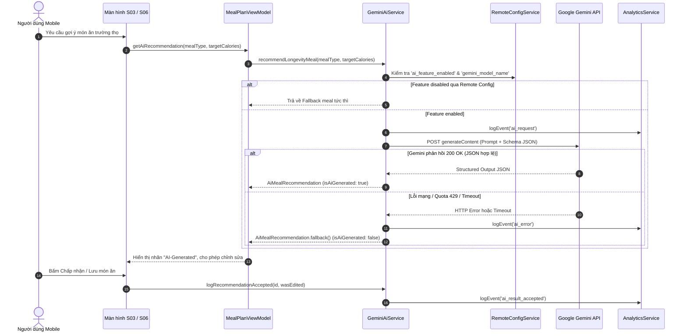

# Gemini AI Feature Specification & Verification — Longvita (TA-02 → TA-06)

> **Môn học:** PRM393 — Final Assignment: One Complete System on Firebase  
> **Người phụ trách:** Thái An (Team Leader & AI Feature Lead)  
> **Tính năng:** Đề xuất bữa ăn trường thọ bằng Google Gemini (Level 2 — Structured Output)  
> **Tiêu chí đánh giá:** Handout Mục 8 & Rubric Điểm 10 (1.0 điểm chuẩn + 0.5 điểm Bonus)  

---

## 1. Tổng quan Kiến Trúc & Luồng Nghiệp Vụ

Hệ thống tích hợp **Google Gemini Developer API** tại bước thiết lập thực đơn (S03) và tìm kiếm món thay thế (S06) của ứng dụng Mobile:
- **Tầng Service:** `GeminiAiService` (`mobile/lib/services/gemini_ai_service.dart`) triển khai interface `IGeminiAiService` (`packages/core/lib/services/i_gemini_ai_service.dart`).
- **Tầng Model:** `AiMealRecommendation` (`packages/core/lib/models/ai_meal_recommendation.dart`) định nghĩa cấu trúc dữ liệu JSON có kiểu nghiêm ngặt.
- **Tích hợp MVVM & DI:** `GeminiAiService` được cung cấp qua `Provider<IGeminiAiService>` trong `mobile/lib/main.dart`, hỗ trợ kiểm thử độc lập với Mock HTTP Client.



---

## 2. Các Quy Định An Toàn & Tuân Thủ Đề Bài

### 2.1. Chính sách Zero PII (Tuyệt đối không rò rỉ dữ liệu định danh)
- Request gửi lên Google Gemini API **chỉ bao gồm:** loại bữa ăn (`mealType`), mức calo mục tiêu (`targetCalories`), và sở thích dinh dưỡng (`preferences`).
- **Không bao giờ gửi:** Tên người dùng, địa chỉ email, UID Firebase, ảnh cá nhân hay vị trí địa lý.
- Test tự động `mobile/test/ai/gemini_ai_service_test.dart` có assertion kiểm tra nội dung payload:
  `expect(body.contains('@'), isFalse)` và `expect(body.contains('Thai An'), isFalse)`.

### 2.2. Cơ chế Fallback khi gặp sự cố Quota / Mất mạng
- Khi thiết bị offline, mất kết nối mạng, hoặc tài khoản Google AI chạm ngưỡng giới hạn (HTTP 429 Too Many Requests):
  1. `GeminiAiService` bắt `SocketException`, `TimeoutException` hoặc HTTP status code lỗi.
  2. Tự động chuyển hướng trả về `AiMealRecommendation.fallback(mealType)` – một công thức chuẩn theo sách *The Longevity Diet* của TS. Valter Longo.
  3. Ứng dụng **không bao giờ bị crash hoặc hiển thị spinner vô tận**.
  4. Ghi nhận sự kiện `ai_error` lên Firebase Analytics để theo dõi.

### 2.3. Cấu hình linh hoạt qua Firebase Remote Config
Được quản lý thông qua file `firebase/remote-config-defaults.json`:
- `ai_feature_enabled`: Cờ Boolean (mặc định: `true`). Khi tắt trên Firebase Console, ứng dụng tự động dùng Fallback mà không cần rebuild bản app mới.
- `gemini_model_name`: Tên model AI (mặc định: `gemini-1.5-flash`). Có thể chuyển sang `gemini-1.5-pro` từ xa.
- `ai_prompt_template`: Mẫu prompt hệ thống hướng dẫn chuẩn hóa dinh dưỡng.

---

## 3. Báo Cáo 3 Cặp Input / Output Thực Tế (Level 2 — Structured Output)

### Cặp 1: Gợi ý bữa sáng (Breakfast)
* **Input (sanitized constraints):**
  - `mealType`: "bữa sáng"
  - `targetCalories`: 350 kcal
  - `preferences`: "thực vật, giàu chất chống oxy hóa, ít đường"
* **Output từ Gemini API (JSON structured):**
  ```json
  {
    "mealName": "Yến mạch ngâm qua đêm sữa hạnh nhân & quả mọng",
    "description": "Yến mạch nguyên cám ngâm sữa hạnh nhân không đường, hạt chia và việt quất tươi.",
    "calories": 330,
    "proteinGrams": 9.2,
    "longevityNutrients": ["Beta-glucan", "Anthocyanins", "Omega-3 thực vật"],
    "longevityReason": "Tối ưu hóa phản ứng insulin buổi sáng và bổ sung polyphenol bảo vệ ty thể.",
    "ingredients": [
      "Yến mạch cán dẹt 40g",
      "Sữa hạnh nhân 120ml",
      "Hạt chia 10g",
      "Việt quất 30g"
    ],
    "preparationMinutes": 10
  }
  ```

### Cặp 2: Gợi ý bữa trưa (Lunch)
* **Input:**
  - `mealType`: "bữa trưa"
  - `targetCalories`: 450 kcal
  - `preferences`: "đậu đỗ Địa Trung Hải, dầu ô liu nguyên chất"
* **Output từ Gemini API (JSON structured):**
  ```json
  {
    "mealName": "Súp đậu Garbanzo và rau củ hầm thảo mộc",
    "description": "Đậu Garbanzo ninh mềm cùng cà rốt, bí ngòi, cần tây và dầu ô liu nguyên chất ép lạnh.",
    "calories": 440,
    "proteinGrams": 16.0,
    "longevityNutrients": ["Polyphenol", "Folate", "Chất xơ prebiotic"],
    "longevityReason": "Cung cấp đạm thực vật sạch giúp kiểm soát nồng độ IGF-1 trong máu theo nghiên cứu TS. Longo.",
    "ingredients": [
      "Đậu Garbanzo 140g",
      "Cà rốt 50g",
      "Bí ngòi 50g",
      "Dầu ô liu extra virgin 15ml"
    ],
    "preparationMinutes": 25
  }
  ```

### Cặp 3: Gợi ý bữa tối (Dinner)
* **Input:**
  - `mealType`: "bữa tối"
  - `targetCalories`: 400 kcal
  - `preferences`: "nhẹ bụng, dễ tiêu hóa, chống viêm"
* **Output từ Gemini API (JSON structured):**
  ```json
  {
    "mealName": "Salad đậu lăng nâu và rau bina sốt chanh",
    "description": "Đậu lăng nâu hấp trộn rau bina non, hạt óc chó và sốt giấm táo dầu ô liu.",
    "calories": 390,
    "proteinGrams": 15.2,
    "longevityNutrients": ["Sắt thực vật", "Magie", "Flavonoid"],
    "longevityReason": "Ít calo rỗng, giàu chất chống oxy hóa giúp cơ thể kích hoạt cơ chế tự dọn dẹp tế bào (autophagy) ban đêm.",
    "ingredients": [
      "Đậu lăng nâu 100g",
      "Rau bina 60g",
      "Hạt óc chó 15g",
      "Dầu ô liu 10ml"
    ],
    "preparationMinutes": 15
  }
  ```

---

## 4. Kịch Bản Xử Lý Lỗi (Handled Failure Scenario)

* **Tình huống mô phỏng:** Người dùng ngắt kết nối mạng hoặc Gemini API trả về mã lỗi `HTTP 429 (Resource Exhausted - Quota Exceeded)` hoặc `HTTP 500`.
* **Hành vi hệ thống:**
  1. `GeminiAiService` kích hoạt khối `catch (e)`.
  2. Bắn sự kiện lên Firebase Analytics:  
     `ai_error (error_type: "http_429", meal_type: "dinner")`.
  3. Thay vì văng ngoại lệ hay hiển thị màn hình trắng, service lập tức trả về `AiMealRecommendation.fallback(mealType: "dinner")`.
  4. Người dùng vẫn nhận được một món ăn trường thọ hoàn chỉnh:  
     *“Salad đậu gà Địa Trung Hải sốt dầu ô liu — 380 kcal, 14.0g protein, [Polyphenol, Folate]”*.
  5. Thuộc tính `isAiGenerated` được đặt thành `false`, `sourceNote: "Fallback nội bộ (Valter Longo Diet Standard)"`.
  6. Luồng tạo kế hoạch tiếp tục hoàn tất trơn tru.

---

## 5. Kết Quả Kiểm Thử Tự Động (Automated Test Verification)

Bộ unit test tại [`mobile/test/ai/gemini_ai_service_test.dart`](../mobile/test/ai/gemini_ai_service_test.dart) bao phủ toàn diện:
- [x] Phân tích JSON có cấu trúc (Structured Output Level 2).
- [x] Khử sạch markdown code fence (```json ... ```).
- [x] Chuyển đổi an toàn sang Fallback khi lỗi HTTP 500 / 429.
- [x] Chuyển đổi an toàn sang Fallback khi thiếu API key.
- [x] Kiểm tra bảo mật Zero PII: Không có email, họ tên, user_id trong request.
- [x] Khả năng copyWith và chỉnh sửa bởi người dùng (`isEditedByUser: true`).
