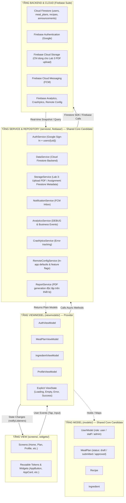
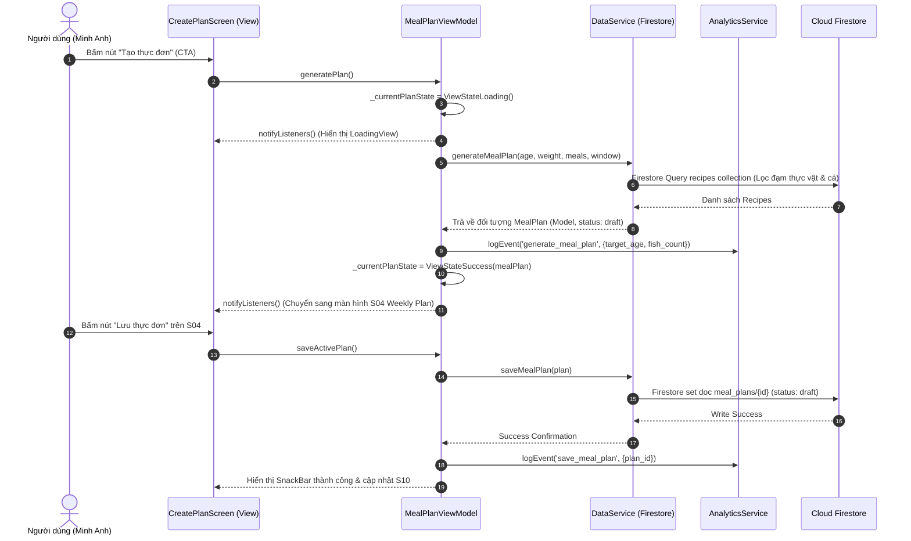

# Architecture Document — Longvita (Lab 3 & Final Assignment Bridge)

> **Trạng thái 02/11/2026:** Các sơ đồ bên dưới mô tả kiến trúc mục tiêu từ skeleton ban đầu. Bootstrap/Auth/session đã có implementation và kiểm chứng nêu trong [bàn giao Charlie](tasks/charlie-progress.md); không suy ra mọi flow/cloud service đã hoàn tất. Lab 3 chính là Assignment; web/shared-core được tích hợp trong cùng sản phẩm. Contract Auth/router/session và các quyết định schema/Storage còn cần owners review.

> **Mô hình kiến trúc:** MVVM (Model - View - ViewModel) với Provider Dependency Injection  
> **Người phụ trách:** Thắng VLQ (Kiến trúc & Tích hợp) | **Phê duyệt:** Thái An (Team Leader)  
> **Nguyên tắc bất biến:** Phụ thuộc một chiều hướng xuống (`Dependencies point downwards only`); một tầng tuyệt đối không import ngược tầng phía trên nó.  
> **Chiến lược chuyển tiếp (Forward-Compatibility):** Thiết kế sẵn sàng đóng gói thành `packages/core/` để chia sẻ cho cả Mobile và Web Admin khi tích hợp yêu cầu toàn hệ thống của Assignment; chi phí thay đổi chưa được đo và không cam kết tỷ lệ phần trăm.

---

## 1. Cấu Trúc Thư Mục (Folder Structure & Core-Readiness)

Cấu trúc `lib/` trong Lab 3 được phân tách rành mạch thành hai khối: **Khối dùng chung (Shared Core Candidate)** và **Khối giao diện Mobile (Mobile Client)**:

```text
lib/
├── # === KHỐI LÕI DÙNG CHUNG (Sẵn sàng chuyển thành packages/core khi lên Assignment) ===
├── models/       # Plain Dart Data Classes (User, MealPlan, Recipe, Ingredient, ViewState)
├── services/     # Interfaces & Cloud Firestore Services (DataService, AuthService, ReportService)
├── firebase/     # Cấu hình Firebase wrappers (Analytics, Crashlytics, Remote Config, Storage)
├── theme/        # Design Tokens Lab 2 (ColorScheme, TextTheme, AppSpacing, AppRadius)
├── widgets/      # 9 Component dùng chung theo Design System (Button, Card, TextField, Dialog...)
│
├── # === KHỐI GIAO DIỆN MOBILE (Sẽ trở thành mobile/ khi lên Assignment) ===
├── viewmodels/   # ViewModels quản lý trạng thái màn hình (ViewState), xử lý business logic
├── screens/      # 10 Màn hình Lab 2 + SignInScreen + ProfileScreen
└── utils/        # Hàm tiện ích thuần túy (date formatters, validators, calculations)
```

> [!IMPORTANT]
> **Quy tắc cô lập Core-Candidate:** Thư mục `models/`, `services/`, `theme/`, `widgets/` tuyệt đối **KHÔNG** import bất kỳ file nào từ `screens/` hoặc `viewmodels/`. Khi chuyển sang Final Assignment, nhóm chỉ cần di chuyển 4 thư mục này sang `packages/core/` mà không dính lỗi vòng lặp import.

---

## 2. Sơ Đồ Phân Tầng Kiến Trúc (Mermaid Layer Diagram)



---

## 3. Quy Tắc Kiến Trúc Bắt Buộc (Architecture Rules)

1. **Chuẩn hóa 100% Cloud Firestore làm Backend duy nhất:**  
   Không sử dụng Mock data hay REST API tạm bợ. Mọi truy vấn thực đơn, danh mục món ăn và dữ liệu người dùng đều kết nối trực tiếp với Firestore Collections (`users`, `recipes`, `meal_plans`).
2. **Tuyệt đối không gọi SDK trực tiếp trong Widget:**  
   Không widget nào được gọi `FirebaseAuth.instance`, `FirebaseFirestore.instance`, `FirebaseAnalytics.instance`... Mọi tương tác ra bên ngoài bắt buộc phải đi qua Service Interface.
3. **Business Logic tách khỏi hàm `build()`:**  
   Các logic tính toán (tính gram đạm theo cân nặng $0.8 \times kg$, đếm số bữa cá $\le 2-3$ bữa/tuần, lọc món thay thế, kiểm tra form nhập số âm) bắt buộc nằm trong ViewModel hoặc Service.
4. **Explicit State Model cho mọi màn hình nạp dữ liệu:**  
   Mỗi màn hình có ViewModel sở hữu trạng thái rõ ràng qua class `ViewState<T>`:
   - `ViewStateIdle<T>`: Chưa bắt đầu tải
   - `ViewStateLoading<T>`: Đang xử lý (kèm nhãn thông điệp)
   - `ViewStateSuccess<T>`: Dữ liệu tải thành công
   - `ViewStateEmpty<T>`: Tải thành công nhưng không có dữ liệu
   - `ViewStateError<T>`: Xảy ra lỗi (có message thân thiện và nút Thử lại - Retry)
5. **Dependency Injection qua Provider:**  
   Mọi Service được đăng ký tại `MultiProvider` ở `main.dart` dưới dạng Interface. ViewModel nhận Service qua Constructor Injection, giúp kiểm thử dễ dàng bằng Fake/Mock Service.
6. **Tách biệt ReportService và StorageService:**  
   `ReportService` chịu trách nhiệm tạo file PDF cục bộ (`Uint8List` / `File`). `StorageService` của Lab 3 chỉ nhận file này để upload lên Firebase Storage. Khi lên Assignment (Storage out-of-scope), nhóm chỉ cần lưu metadata vào Firestore mà không cần sửa `ReportService`.

---

## 4. Sơ Đồ Tuần Tự (Sequence Diagram — Luồng Lập & Lưu Thực Đơn)



---

## 5. Bảng Ánh Xạ ViewModels và Các Services Sử Dụng

| Tên ViewModel | File | Trách nhiệm chính | Các Services phụ thuộc (Injected via Constructor) |
|:---|:---|:---|:---|
| **`AuthViewModel`** | `lib/viewmodels/auth_viewmodel.dart` | Quản lý đăng nhập Google, lưu thông tin user vào Firestore `users/{uid}` (gắn sẵn `role: 'user'`), đồng bộ trạng thái đăng xuất | `AuthService`, `AnalyticsService`, `CrashlyticsService` |
| **`MealPlanViewModel`** | `lib/viewmodels/meal_plan_viewmodel.dart` | Quản lý Flow 1 & Flow 3: thiết lập sở thích (S02), sinh thực đơn 7 ngày (S03-S04), lưu kế hoạch vào Firestore `meal_plans` với `status: 'draft'`, tra cứu món thay thế (S06) | `DataService`, `AnalyticsService`, `CrashlyticsService`, `RemoteConfigService` |
| **`IngredientViewModel`** | `lib/viewmodels/ingredient_viewmodel.dart` | Quản lý Flow 2: tổng hợp nguyên liệu (S07), chỉnh sửa số lượng có validation, hoàn tác Undo, đồng bộ danh sách mua sắm (S08) | `AnalyticsService`, `CrashlyticsService` |
| **`ProfileViewModel`** | `lib/viewmodels/profile_viewmodel.dart` | Quản lý màn Profile & Firebase Demo Area: danh sách thông báo FCM, sinh PDF cục bộ (`ReportService`), demo upload (`StorageService`), đọc/đổi Remote Config, kích hoạt lỗi Crashlytics | `StorageService`, `NotificationService`, `ReportService`, `RemoteConfigService`, `CrashlyticsService`, `AnalyticsService` |

---

## 6. Lộ Trình Chuyển Tiếp Sang Final Assignment (Bridge Roadmap)

Khi hoàn thành Lab 3 và chuyển tiếp sang Final Assignment, nhóm chỉ cần thực hiện 4 bước đóng gói:
1. **Trích xuất `packages/core/`:** Di chuyển `models/`, `services/`, `theme/`, `widgets/` ra `packages/core/` để chia sẻ cho cả `mobile/` và `web/`.
2. **Kích hoạt Cross-Role Flow:** Nâng cấp trường `status` của `MealPlan` từ `'draft'` $\to$ `'submitted'` $\to$ Web Admin chuyển `'approved'`.
3. **Thêm Web Admin:** Xây dựng 4 màn hình Web trên nền Firestore rules đã có sẵn.
4. **Tích hợp Gemini AI:** Thêm Firebase AI Logic qua Remote Config flag.
