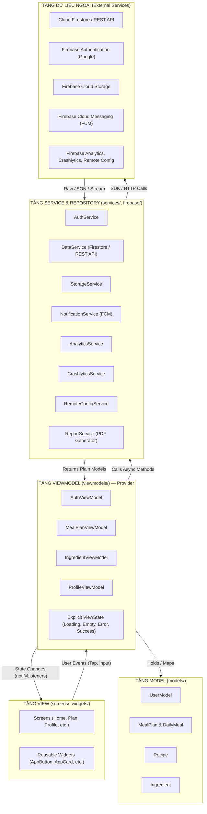
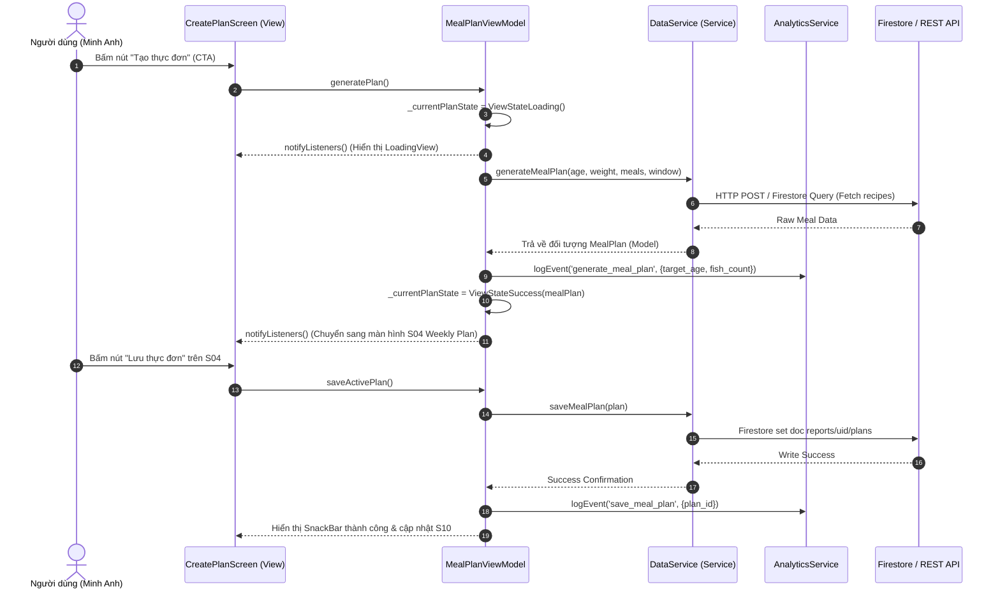

# Architecture Document — Longvita (Lab 3)

> **Mô hình kiến trúc:** MVVM (Model - View - ViewModel) với Provider Dependency Injection  
> **Người phụ trách:** Thắng VLQ (Kiến trúc & Tích hợp)  
> **Nguyên tắc bất biến:** Phụ thuộc một chiều hướng xuống (`Dependencies point downwards only`); một tầng tuyệt đối không import ngược tầng phía trên nó.

---

## 1. Cấu Trúc Thư Mục (Folder Structure — 1 Dòng / Thư Mục)

```text
lib/
├── models/       # Chứa các Plain Dart Data Classes (User, MealPlan, Recipe, Ingredient, ViewState), dùng chung cho toàn bộ app
├── services/     # Chứa các Interfaces và Implementations gọi REST API, Local DB, sinh PDF báo cáo
├── firebase/     # Chứa các mã bọc dịch vụ Firebase (Auth, Cloud Storage, FCM, Remote Config, Analytics, Crashlytics)
├── viewmodels/   # Chứa các ViewModels quản lý trạng thái màn hình (ViewState), xử lý business logic và gọi Services
├── screens/      # Chứa các Màn hình giao diện (Views) lắng nghe State từ ViewModel, chỉ forward sự kiện người dùng
├── widgets/      # Chứa 9 Component dùng chung theo Design System Lab 2 (Button, TextField, Card, Dialog, Loading...)
├── theme/        # Chứa toàn bộ Design Tokens: ColorScheme, TextTheme, AppSpacing, AppRadius, AppElevation
└── utils/        # Chứa các hàm tiện ích thuần túy (date formatting, validators, constants)
```

---

## 2. Sơ Đồ Phân Tầng Kiến Trúc (Mermaid Layer Diagram)



---

## 3. Quy Tắc Kiến Trúc Bắt Buộc (Architecture Rules)

1. **Tuyệt đối không gọi SDK trực tiếp trong Widget:**  
   Không có bất kỳ widget nào được gọi `http`, `FirebaseAuth.instance`, `FirebaseAnalytics.instance`, `FirebaseFirestore.instance`... Mọi tương tác ra bên ngoài bắt buộc phải đi qua Service Interface.
2. **Business Logic tách khỏi hàm `build()`:**  
   Các logic tính toán (tính gram đạm theo cân nặng $0.8 \times kg$, đếm số bữa cá $\le 2-3$ bữa/tuần, lọc món thay thế, kiểm tra form nhập số âm) bắt buộc nằm trong ViewModel hoặc Service, tuyệt đối không viết trong hàm `build()`.
3. **Explicit State Model cho mọi màn hình nạp dữ liệu:**  
   Mỗi màn hình có ViewModel sở hữu trạng thái rõ ràng qua class `ViewState<T>`:
   - `ViewStateIdle<T>`: Chưa bắt đầu tải
   - `ViewStateLoading<T>`: Đang xử lý (kèm nhãn thông điệp)
   - `ViewStateSuccess<T>`: Dữ liệu tải thành công
   - `ViewStateEmpty<T>`: Tải thành công nhưng không có dữ liệu
   - `ViewStateError<T>`: Xảy ra lỗi (có message thân thiện và nút Thử lại - Retry)
4. **Dependency Injection qua Provider:**  
   Mọi Service được đăng ký tại `MultiProvider` ở `main.dart` dưới dạng Interface. ViewModel nhận Service qua Constructor Injection, giúp kiểm thử dễ dàng bằng Fake/Mock Service.

---

## 4. Sơ Đồ Tuần Tự (Sequence Diagram — Luồng Lập & Lưu Thực Đơn)



---

## 5. Bảng Ánh Xạ ViewModels và Các Services Sử Dụng

| Tên ViewModel | File | Trách nhiệm chính | Các Services phụ thuộc (Injected via Constructor) |
|:---|:---|:---|:---|
| **`AuthViewModel`** | `lib/viewmodels/auth_viewmodel.dart` | Quản lý đăng nhập Google, trạng thái phiên làm việc, xóa dữ liệu khi đăng xuất, cập nhật user ID | `AuthService`, `AnalyticsService`, `CrashlyticsService` |
| **`MealPlanViewModel`** | `lib/viewmodels/meal_plan_viewmodel.dart` | Quản lý Flow 1 & Flow 3: thiết lập sở thích (S02), sinh thực đơn 7 ngày (S03-S04), lưu kế hoạch (S10), tra cứu món thay thế (S06) | `DataService`, `AnalyticsService`, `CrashlyticsService`, `RemoteConfigService` |
| **`IngredientViewModel`** | `lib/viewmodels/ingredient_viewmodel.dart` | Quản lý Flow 2: tổng hợp nguyên liệu (S07), chỉnh sửa số lượng có validation, hoàn tác Undo, đồng bộ trạng thái mua sắm (S08) | `AnalyticsService`, `CrashlyticsService` |
| **`ProfileViewModel`** | `lib/viewmodels/profile_viewmodel.dart` | Quản lý màn Profile & Firebase Demo Area: danh sách thông báo FCM, sinh PDF và upload Storage có progress, đọc/đổi Remote Config, kích hoạt lỗi Crashlytics | `StorageService`, `NotificationService`, `ReportService`, `RemoteConfigService`, `CrashlyticsService`, `AnalyticsService` |
