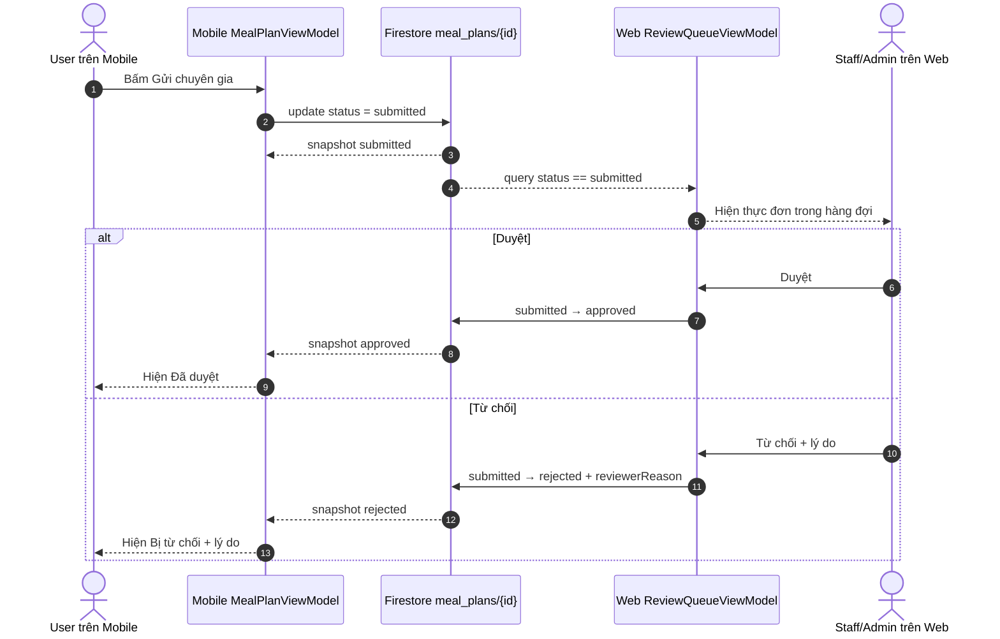

# TV-04 — Luồng liên vai trò Mobile ↔ Web Admin

> **Cập nhật:** 11/11/2026
> **Owner:** Thắng VLQ; phối hợp Hoàng DV
> **Trạng thái:** đặc tả và quy trình đo đã hoàn thành; Firebase Hosting TV-00
> đã hoạt động. Ba lượt chạy live còn chờ Mobile HD-05, Rules production đúng
> bản và tài khoản demo đúng role.

## 1. Mục tiêu và phạm vi

Luồng chứng minh một thực đơn do người dùng gửi từ Mobile được Staff/Admin xử
lý trên Web, rồi kết quả đồng bộ ngược về Mobile qua cùng document Firestore.
Longvita dùng trạng thái `submitted` thay cho từ `pending` trong ví dụ handout;
tên này đã được thống nhất trong model, rules, Mobile và Web.

Luồng không dùng Cloud Storage, không cho client tự đổi role và không dùng dữ
liệu giả để tuyên bố kết quả production. Nội dung công thức/thực đơn thử nghiệm
không chứa tên, email hoặc định danh cá nhân trong ảnh công khai.

## 2. Tiền điều kiện cho lượt chạy live

- Mobile build và Web build cùng trỏ tới project `longvita-8da7e`.
- Tài khoản Mobile có `users/{uid}.role = user`.
- Tài khoản Web có role `staff` hoặc `admin`; tài khoản `user` phải bị Web từ
  chối để chứng minh role gate.
- Thực đơn có đủ 7 ngày và đang ở trạng thái `draft`.
- `firebase/firestore.rules` đang deploy đúng bản được test; Hosting URL mở
  được ở cửa sổ ẩn danh.
- Đồng hồ dùng để đo lấy từ cùng một máy hoặc được đồng bộ trước khi chạy.

## 3. Sequence diagram

## 4. Hợp đồng trạng thái và quyền

| Từ | Sang | Actor | Điều kiện chính |
|---|---|---|---|
| `draft` | `submitted` | owner trên Mobile | đủ 7 ngày; chỉ sửa các trường được rules cho phép |
| `submitted` | `approved` | `staff`/`admin` trên Web | chỉ đổi `status` và `reviewerReason` |
| `submitted` | `rejected` | `staff`/`admin` trên Web | `reviewerReason` không rỗng, tối đa 500 ký tự |
| `approved`/`rejected` | trạng thái khác | không ai | trạng thái cuối; rules từ chối |

Nguồn chuẩn: `docs/data-model.md`, `firebase/firestore.rules`,
`mobile/lib/viewmodels/meal_plan_viewmodel.dart` và
`packages/core/lib/services/admin_service.dart` (được Web sử dụng qua shared
core).

## 5. Kịch bản chạy live

1. Mở Mobile bằng tài khoản `user`, mở một thực đơn `draft` đủ 7 ngày.
2. Bắt đầu ghi màn hình và ghi `T0` ngay trước khi bấm **Gửi chuyên gia**.
3. Bấm gửi; ghi `T1` khi Mobile hiển thị trạng thái đã gửi.
4. Trên Web đã đăng nhập `staff/admin`, ghi `T2` khi item xuất hiện trong hàng
   đợi mà không reload thủ công.
5. Lượt 1 và 3 chọn **Duyệt**; lượt 2 chọn **Từ chối**, nhập lý do không chứa
   PII. Ghi `T3` ngay trước thao tác xác nhận.
6. Ghi `T4` khi Web báo thao tác thành công và item rời hàng đợi.
7. Ghi `T5` khi Mobile tự cập nhật trạng thái cuối mà không restart app.
8. Đối chiếu document Firestore, lưu ảnh/video và log đã khử UID/email.

## 6. Cách tính độ trễ

- Mobile submit acknowledgement: `T1 - T0`.
- Mobile → Web queue: `T2 - T1`.
- Web review acknowledgement: `T4 - T3`.
- Web → Mobile final status: `T5 - T4`.
- End-to-end: `T5 - T0`.

Thời gian ghi bằng millisecond từ cùng một clock. Nếu một mốc không quan sát
được, lượt chạy là **Invalid** và phải chạy lại; không thay bằng ước lượng.

## 7. Bảng ba lượt chạy live

| Lượt | Quyết định | Submit ack (ms) | Mobile→Web (ms) | Review ack (ms) | Web→Mobile (ms) | E2E (ms) | Kết quả | Evidence |
|---:|---|---:|---:|---:|---:|---:|---|---|
| 1 | Approve | — | — | — | — | — | Chưa chạy | Chờ HD-05/tài khoản/Rules production |
| 2 | Reject | — | — | — | — | — | Chưa chạy | Chờ HD-05/tài khoản/Rules production |
| 3 | Approve | — | — | — | — | — | Chưa chạy | Chờ HD-05/tài khoản/Rules production |

Chỉ thay dấu `—` bằng số đo quan sát được và dẫn file trong
`evidence/cross_role/`. Không đánh dấu TV-04 hoàn thành khi chưa đủ ba lượt hợp
lệ trên hệ thống deploy.

## 8. Kiểm tra âm tính bắt buộc

- Tài khoản `user` đăng nhập Web bị từ chối.
- Owner không thể tự chuyển `submitted → approved/rejected`.
- Staff/admin không thể review lại document đã ở trạng thái cuối.
- Reject không có lý do bị UI chặn và rules từ chối nếu cố ghi trực tiếp.
- Document lỗi cấu trúc vẫn hiện cảnh báo, không thể approve nhưng có thể reject
  để dọn hàng đợi.

## 9. Giới hạn hiện tại

- Hosting production đã deploy tại `https://longvita-8da7e.web.app`; HTTP 200,
  mở ẩn danh, đăng nhập Admin và từ chối role `user` đã được kiểm tra. Lượt
  deploy chỉ gồm Hosting, không chứng minh Firestore Rules production đã đúng
  bản hoặc luồng cross-role đã chạy.
- Chưa chạy ba lượt cross-role live và chưa ghi production Firestore trong bước
  đo TV-04.
- `publish_announcement` thuộc CM-07, không phải điều kiện của luồng duyệt thực
  đơn TV-04.
