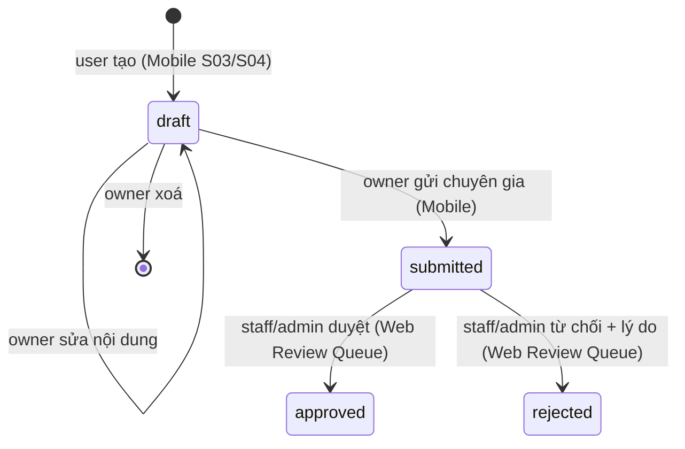

# Data model và phân quyền — Longvita Final (CM-01)

> Căn cứ: handout *PRM393 Final Assignment*, mục 6, Appendix A và Appendix B.
> Nguồn sự thật: `firebase/firestore.rules` và các model trong `lib/models/`. Khi hai nguồn này đổi, cập nhật file này trong cùng PR.
> Kiểm chứng: `firebase/tests/firestore.rules.matrix.test.js` (bảng Appendix B ở mục 6) và `firebase/tests/firestore.rules.test.js` (ca biên chi tiết).

## 1. Vai trò

| Role | Client | Được làm gì |
|---|---|---|
| `user` | Mobile (Flutter) | Persona Lab 2: xem công thức, tạo/gửi thực đơn tuần, danh sách mua sắm, xuất PDF, đọc thông báo. |
| `staff` | Web Admin (Flutter Web) | Chuyên gia dinh dưỡng: quản lý công thức, duyệt/từ chối thực đơn, đăng thông báo. |
| `admin` | Web Admin | Mọi quyền của staff, cộng xem danh sách người dùng và đổi role người khác. |

- Role lưu tại `users/{uid}.role`. Lần đăng nhập đầu, Mobile tự tạo hồ sơ với `role = 'user'`; client không thể tự tạo `staff` hay `admin`.
- **Admin đầu tiên** được đặt thủ công trong Firebase Console (sửa trường `role` của tài khoản đó thành `admin`) và ghi tên trong `README.md` (CM-05).
- Chỉ admin đổi role, chỉ trường `role`, chỉ của người khác. Không ai tự đổi role của mình, kể cả admin.
- Mỗi client từ chối tài khoản sai role với thông báo rõ: Web chỉ nhận `staff`/`admin` (CM-06), Mobile chỉ nhận `user` (HD-03B). Rules là lớp chặn cuối, không thay cho kiểm tra ở client.

## 2. Bảng tổng hợp (Appendix A)

| Collection | Key fields (type) | Create | Read | Update | Delete | Used by screens |
|---|---|---|---|---|---|---|
| `users/{uid}` | `role` (string: user, staff, admin), `displayName` (string ≤ 120), `email`, `photoUrl?`, `createdAt` | Self khi đăng nhập lần đầu, `role = user` | Self; admin | Self: `displayName`, `photoUrl`. Admin: chỉ `role` của người khác | — | Mobile Sign-in, Profile; Web role gate (CM-06) |
| `recipes/{id}` | `name` (string ≤ 120), `category`, `proteinGrams`, `calories` (number ≥ 0), `ingredients[]`, `instructions[]`, `isArchived` (bool) | Staff, admin | Mọi người đã đăng nhập | Staff, admin (gồm archive/restore) | — (archive thay cho xoá) | Mobile S01, S03, S05, S06; Web RecipeManagement (TV-01), Dashboard (TV-03) |
| `meal_plans/{id}` | `uid`, `title` (string ≤ 120), `status` (draft, submitted, approved, rejected), `reviewerReason?` (≤ 500), `days[]` (≤ 7) | User cho chính mình, `status = draft` | Owner; staff, admin | Owner khi `draft`; staff/admin duyệt (mục 4) | Owner khi `draft` | Mobile S03, S04, S10; Web ReviewQueue (TV-02), Dashboard (TV-03) |
| `shopping_lists/{uid}/plans/{planId}` | `uid`, `planId`, `updatedAt`, `items[]` (≤ 500) | Owner | Owner | Owner | Owner | Mobile S07, S08 |
| `users/{uid}/report_exports/{exportId}` | `exportId`, `planId?`, `fileName`, `sizeBytes` (int ≤ 10 MB), `schemaVersion = 1`, `createdAt` | Owner, plan phải thuộc owner | Owner | Owner, chỉ retry cùng payload | — | Mobile Profile (xuất PDF, trạng thái đồng bộ metadata) |
| `announcements/{id}` | `title` (string ≤ 120), `content` (string ≤ 2000), `authorRole`, `createdAt` | Staff, admin; `authorRole` = role thật | Mọi người đã đăng nhập | Staff, admin: chỉ `title`, `content` | Staff, admin | Mobile S01 Inbox (HD-04); Web AnnouncementForm (CM-07) |

Mọi đường dẫn không nằm trong bảng trên đều bị chặn (`match /{document=**} { allow read, write: if false; }`). Không có rule `if true`.

## 3. Chi tiết trường

Thời gian (`createdAt`, `updatedAt`) hiện là chuỗi ISO-8601 do client ghi, giữ nguyên từ Lab 3. Chuyển sang `serverTimestamp` cần đổi model, rules và dữ liệu cùng lúc nên chưa làm.

### 3.1 `users/{uid}` — `lib/models/user_model.dart`

| Field | Type | Bắt buộc | Ràng buộc |
|---|---|---|---|
| `email` | string | có | ≤ 320 ký tự; không sửa sau khi tạo |
| `displayName` | string | có | 1–120 ký tự |
| `photoUrl` | string \| null | không | ≤ 2048 ký tự |
| `role` | string | có | `user`, `staff` hoặc `admin` |
| `createdAt` | string | có | không sửa sau khi tạo |

Không trường nào khác được ghi (`hasOnly`). Staff không đọc được hồ sơ người khác, nên Dashboard không đếm trên `users` (xem mục 7).

### 3.2 `recipes/{id}` — `lib/models/recipe_model.dart`

| Field | Type | Bắt buộc | Ràng buộc |
|---|---|---|---|
| `name` | string | có | 1–120 ký tự |
| `description` | string | có | ≤ 2000 ký tự |
| `category` | string | có | 1–60 ký tự |
| `proteinGrams`, `calories` | number | có | ≥ 0 |
| `ingredients` | list | có | ≤ 50 phần tử |
| `instructions` | list | có | ≤ 30 bước |
| `imageUrl` | string \| null | không | ≤ 2048 ký tự |
| `sourceNote` | string | có | ≤ 1000 ký tự, nguồn trích dẫn |
| `isArchived` | bool | không | thiếu = đang dùng; `true` = đã lưu trữ |

### 3.3 `meal_plans/{id}` — `lib/models/meal_plan_model.dart`

| Field | Type | Bắt buộc | Ràng buộc |
|---|---|---|---|
| `uid` | string | có | = UID người tạo; không đổi |
| `title` | string | có | 1–120 ký tự |
| `targetCalories`, `targetProteinGrams` | number | có | ≥ 0 |
| `status` | string | có | `draft`, `submitted`, `approved`, `rejected` |
| `reviewerReason` | string \| null | không | ≤ 500; bắt buộc khi `rejected`; chỉ staff/admin ghi |
| `days` | list | có | ≤ 7; `DataService` đòi đủ 7 ngày trước khi lưu |
| `createdAt` | string | có | không đổi |

### 3.4 `shopping_lists/{uid}/plans/{planId}`

`uid` và `planId` phải khớp đường dẫn; `items` là list ≤ 500 phần tử; `updatedAt` là chuỗi. Chỉ chủ sở hữu đọc/ghi.

### 3.5 `users/{uid}/report_exports/{exportId}`

Metadata của PDF lưu trên máy (không có bản PDF trên cloud). Hợp đồng đầy đủ ở `docs/pdf-export-contract.md`: ID dạng `pdf_YYYYMMDDTHHMMSSZ_<16 hex>`, `fileName = exportId + '.pdf'`, `sizeBytes` từ 1 byte đến 10 MB, `planId` là null hoặc plan của chính owner. Cập nhật chỉ hợp lệ khi payload giống hệt (retry an toàn); không cho xoá để giữ lịch sử.

### 3.6 `announcements/{id}` — `lib/models/announcement_model.dart`

`title` 1–120 ký tự, `content` 1–2000 ký tự, `authorRole` phải bằng role thật của người đăng (staff không mạo danh admin), `createdAt` là chuỗi. Khi sửa chỉ được đổi `title`, `content`.

## 4. Chuyển trạng thái `meal_plans.status`



| Từ | Sang | Ai | Điều kiện trong rules |
|---|---|---|---|
| (mới) | `draft` | user (owner) | `uid == auth.uid`, chưa có `reviewerReason` |
| `draft` | `draft` / `submitted` | owner | chỉ đổi `title`, `targetCalories`, `targetProteinGrams`, `status`, `days` |
| `submitted` | `approved` | staff, admin | chỉ đổi `status`, `reviewerReason` |
| `submitted` | `rejected` | staff, admin | như trên, `reviewerReason` không rỗng, ≤ 500 |
| `approved`, `rejected` | — | không ai | trạng thái cuối; owner tạo thực đơn mới nếu muốn gửi lại |

Đây là luồng liên vai trò của bài (Appendix C, `docs/cross-role-flow.md` do TV-04 viết). Handout dùng ví dụ `pending`; Longvita dùng `submitted` từ Lab 3 với cùng ý nghĩa, Mobile và Web PR #25 đều đã dùng tên này nên không đổi.

## 5. Nguyên tắc Security Rules

1. Deny by default cho mọi đường dẫn; không có `if true`.
2. Role đọc từ `users/{request.auth.uid}.role` qua `get()`; không tin role do client gửi.
3. Validate hình dạng bằng `keys().hasOnly()` + `hasAll()`, kiểu dữ liệu và giới hạn kích thước cho từng trường văn bản và danh sách.
4. Update giới hạn trường được đổi bằng `diff().affectedKeys()`, nên không sửa được `uid`, `createdAt`, `email`.
5. Chuyển trạng thái kiểm cả trạng thái cũ (`resource.data.status`) và mới.
6. Xoá cứng bị chặn ở nơi cần giữ lịch sử: `users`, `recipes` (dùng `isArchived`), `report_exports`.

## 6. Bảng test rules (Appendix B)

Chạy trên Firestore Emulator, project demo `demo-longvita`, không chạm project thật:

```bash
cd firebase && npm ci && npm run test:rules
```

| ID | Collection | Role | Operation | Expected | Result |
|---|---|---|---|---|---|
| R-01 | users | anonymous | read a profile | Denied | Pass |
| R-02 | users | user | first sign-in creates own profile with role = user | Allowed | Pass |
| R-03 | users | user | update own role to admin | Denied | Pass |
| R-04 | users | staff | read own profile (role gate) | Allowed | Pass |
| R-05 | users | staff | read another user profile | Denied | Pass |
| R-06 | users | admin | change another user role to staff | Allowed | Pass |
| R-07 | users | admin | change own role | Denied | Pass |
| R-08 | recipes | anonymous | read a recipe | Denied | Pass |
| R-09 | recipes | user | read a recipe | Allowed | Pass |
| R-10 | recipes | user | create a recipe | Denied | Pass |
| R-11 | recipes | staff | archive a recipe (isArchived = true) | Allowed | Pass |
| R-12 | recipes | staff | hard delete a recipe | Denied | Pass |
| R-13 | recipes | admin | create a valid recipe | Allowed | Pass |
| R-14 | recipes | admin | create a recipe with name over 120 chars | Denied | Pass |
| R-15 | meal_plans | anonymous | read a plan | Denied | Pass |
| R-16 | meal_plans | user | owner submits draft (draft → submitted) | Allowed | Pass |
| R-17 | meal_plans | user | owner self-approves (submitted → approved) | Denied | Pass |
| R-18 | meal_plans | staff | approve a plan (submitted → approved) | Allowed | Pass |
| R-19 | meal_plans | staff | reject a plan without a reason | Denied | Pass |
| R-20 | meal_plans | admin | reject a plan with a reason | Allowed | Pass |
| R-21 | meal_plans | admin | review an already approved plan (approved → rejected) | Denied | Pass |
| R-22 | shopping_lists | anonymous | read a shopping list | Denied | Pass |
| R-23 | shopping_lists | user | owner saves own checklist | Allowed | Pass |
| R-24 | shopping_lists | user | write another user checklist | Denied | Pass |
| R-25 | shopping_lists | staff | save own checklist | Allowed | Pass |
| R-26 | shopping_lists | staff | read a user checklist | Denied | Pass |
| R-27 | shopping_lists | admin | save own checklist | Allowed | Pass |
| R-28 | shopping_lists | admin | read a user checklist | Denied | Pass |
| R-29 | report_exports | anonymous | read export metadata | Denied | Pass |
| R-30 | report_exports | user | owner records PDF metadata of own plan | Allowed | Pass |
| R-31 | report_exports | user | owner deletes export history | Denied | Pass |
| R-32 | report_exports | staff | record metadata of an unsaved plan (planId = null) | Allowed | Pass |
| R-33 | report_exports | staff | read a user export history | Denied | Pass |
| R-34 | report_exports | admin | record metadata of an unsaved plan (planId = null) | Allowed | Pass |
| R-35 | report_exports | admin | read a user export metadata | Denied | Pass |
| R-36 | announcements | anonymous | read announcements | Denied | Pass |
| R-37 | announcements | user | stream newest announcements (Inbox) | Allowed | Pass |
| R-38 | announcements | user | publish an announcement | Denied | Pass |
| R-39 | announcements | staff | publish an announcement as staff | Allowed | Pass |
| R-40 | announcements | staff | publish posing as admin | Denied | Pass |
| R-41 | announcements | admin | publish an announcement as admin | Allowed | Pass |
| R-42 | announcements | admin | publish with content over 2000 chars | Denied | Pass |

Ngoài bảng trên, `firestore.rules.test.js` giữ các ca biên chi tiết (mạo danh, đổi `uid`/`createdAt`, nhảy trạng thái, kích thước biên, retry metadata). Kết quả chạy và log nằm trong `evidence/rules/CM-04-20261109/`.

## 7. Giới hạn đã biết

- **Danh sách lồng nhau:** Rules không duyệt được từng phần tử trong `days`, `ingredients`, `items` (không có vòng lặp), chỉ kiểm kiểu list và số phần tử. Client kiểm phần còn lại.
- **Công thức đã lưu trữ:** mọi người đăng nhập vẫn đọc được recipe có `isArchived = true`. Mobile cần ẩn chúng khi hiển thị; lọc bằng rules sẽ bắt mọi truy vấn Mobile thêm điều kiện `where`, nên chưa làm.
- **Dashboard:** staff không đọc `users`, nên ba chỉ số của TV-03 đếm trên `recipes` và `meal_plans`. Số người dùng chỉ hiển thị cho admin hoặc qua bộ đếm riêng nếu nhóm cần.
- **Thực đơn bị từ chối** là trạng thái cuối; chưa có luồng sửa và gửi lại cùng document.
- Rules mới trong file này **chưa deploy** lên project `longvita-8da7e`. Deploy cần nhóm duyệt và chạy lại bộ test trên đúng bản deploy.
