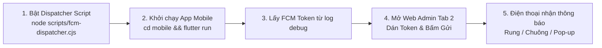

# Hướng dẫn Thiết lập & Vận hành Hệ thống Thông báo (FCM & In-App)

> **Tài liệu hướng dẫn kỹ thuật dự án LongvitaRC**  
> **Cập nhật ngày:** 12/11/2026  
> **Áp dụng cho:** Bài Lab 3 (Cloud Messaging FCM) & Đồ án thực tế.

---

## 1. Tổng quan Kiến trúc 2 Luồng Thông báo

Hệ thống thông báo của Longvita được chia thành **2 cơ chế độc lập** trên Web Admin:

| Tính năng | Tab 1: Bản tin trong app (In-App) | Tab 2: Thông báo đẩy (FCM Push) |
| :--- | :--- | :--- |
| **Bản chất** | Cloud Firestore Realtime Stream | Firebase Cloud Messaging (FCM HTTP v1) |
| **Hiển thị** | Màn hình **Trang chủ (`HomeScreen`)** > mục **"Hộp thư thông báo"** | **Màn hình khóa / Khay hệ thống Android** và **màn hình Hồ sơ (`ProfileScreen`)** |
| **Mục đích** | Lưu trữ bản tin dài, không làm phiền người dùng | Rung chuông tức thì kéo người dùng quay lại app |
| **Cách gửi** | Ghi document vào `announcements` | Ghi vào `fcm_broadcasts` -> Dispatcher bắn FCM |

---

## 2. Chuẩn bị Môi trường (Prerequisites)

1. **File khóa bí mật Service Account:**
   * File `firebase/service-account.json` bắt buộc phải có trong thư mục `firebase/`.
   * *Lưu ý an toàn:* File này đã được đưa vào `.gitignore`, tuyệt đối không commit lên Git public.
2. **Thư viện Node.js:**
   * Đã cài đặt `firebase-admin` trong thư mục `firebase/node_modules`.
3. **Thiết bị Mobile Android:**
   * Đã bật quyền thông báo trong **Cài đặt > Ứng dụng > Longvita > Thông báo (Cho phép)**.

---

## 3. Quy trình Vận hành Từng bước cho Ngày mai (Runbook)



### Bước 1: Khởi động Script Listener (FCM Dispatcher)
Mở một cửa sổ Terminal tại thư mục gốc của project (`LongvitaRC`) và chạy:
```bash
node scripts/fcm-dispatcher.cjs
```
Khi chạy thành công, Terminal sẽ hiển thị:
```text
====================================================
🚀 LONGVITA FCM DISPATCHER DAEMON ĐANG HOẠT ĐỘNG
📁 Project: longvita-8da7e
🔑 Service Account: firebase-adminsdk-fbsvc@longvita-8da7e.iam.gserviceaccount.com
📡 Đang lắng nghe hàng đợi "fcm_broadcasts"...
====================================================
```
*(Giữ cửa sổ Terminal này luôn chạy trong suốt quá trình demo).*

---

### Bước 2: Khởi chạy Ứng dụng Mobile
Mở một cửa sổ Terminal khác và khởi động app:
```bash
cd mobile
flutter run
```
1. Đăng nhập vào tài khoản trên điện thoại.
2. Nhìn vào log debug trên Terminal, copy dòng **FCM token**:
   ```text
   FCM token: cFuFdUGPQBmUbfN1lvkW1x:APA91bHNz...
   ```
*(Mỗi lần cài lại app hoặc trên máy khác nhau, token này sẽ có thể thay đổi).*

---

### Bước 3: Mở Web Admin & Bắn Thông báo

Truy cập Web Admin: **https://longvita-8da7e.web.app**

1. Vào mục **Thông báo** trên thanh menu bên trái.
2. Chọn **Tab 2: Thông báo đẩy (Push Notification - FCM)**:
   * **Tiêu đề:** Nhập tiêu đề ngắn gọn (VD: `Nhắc nhở bữa trưa`).
   * **Nội dung:** Nhập nội dung (VD: `Đã đến giờ chuẩn bị thực đơn dinh dưỡng tuần mới!`).
   * **Hình thức gửi:** Chọn **Người dùng cụ thể (Theo UID)**.
   * **Ô nhập UID/Token:** Dán chuỗi **FCM token** vừa copy ở Bước 2 vào đây.
3. Bấm **Bắn thông báo đẩy (FCM)**.
4. **Kết quả:** Script trên terminal Bước 1 sẽ lập tức in log:
   ```text
   ✅ [THÀNH CÔNG] Đã bắn Push Notification...
   ```
   Và điện thoại của bạn sẽ rung, chuông và hiện thông báo đẩy ngay lập tức!

---

## 4. Kịch bản Thu thập Bằng chứng (Evidence) cho Lab 3

Để lấy trọn vẹn điểm Lab 3 theo yêu cầu của giảng viên, bạn thực hiện test 3 trạng thái:

1. **Trạng thái 1 — Foreground (Đang mở app):**
   * Giữ app Longvita đang mở trên màn hình điện thoại.
   * Bấm gửi từ Web Admin.
   * *Kết quả:* App hiển thị thanh thông báo (Banner/SnackBar) ở đáy màn hình kèm nút **"Xem"**. 👉 **Chụp ảnh màn hình 1**.
2. **Trạng thái 2 — Background (Chạy nền):**
   * Bấm phím **Home** để thu nhỏ app xuống nền.
   * Bấm gửi từ Web Admin.
   * *Kết quả:* Khay hệ thống Android kêu chuông và hiện pop-up thông báo. 👉 **Chụp ảnh màn hình 2**.
   * Chạm vào thông báo: app tự động mở vào màn hình **Hồ sơ (Profile)**. 👉 **Chụp ảnh màn hình 3**.
3. **Trạng thái 3 — Terminated (Đã tắt hoàn toàn app):**
   * Mở trình đa nhiệm của Android, vuốt tắt hoàn toàn ứng dụng Longvita.
   * Bấm gửi từ Web Admin.
   * *Kết quả:* Điện thoại vẫn nhận được thông báo ngoài khay hệ thống. 👉 **Chụp ảnh màn hình 4**.
   * Chạm vào thông báo: app tự khởi động lại từ đầu và mở vào màn hình Hồ sơ. 👉 **Chụp ảnh màn hình 5**.
4. **Lịch sử lưu trữ (Retention):**
   * Tại màn hình **Hồ sơ (Profile)**, cuộn xuống mục **"Thông báo"**: toàn bộ các tin nhắn đã nhận đều được lưu trữ đầy đủ. 👉 **Chụp ảnh màn hình 6**.

---

## 5. Xử lý Sự cố Thường gặp (Troubleshooting)

| Lỗi gặp phải | Nguyên nhân | Cách khắc phục |
| :--- | :--- | :--- |
| `Không tìm thấy file khóa service-account.json` | Chưa copy file khóa vào thư mục `firebase/` | Tải lại file từ Firebase Console > Project Settings > Service accounts > Bỏ vào `firebase/service-account.json`. |
| `BatchGetDocuments failed 403 Forbidden` | Rules chưa cập nhật quyền đọc khi document chưa tồn tại | Chạy `npx firebase-tools deploy --only firestore:rules --project longvita-8da7e`. |
| Web Admin không hiển thị 2 Tab mới | Trình duyệt bị lưu cache bản cũ | Bấm **Ctrl + F5** (hoặc mở trình duyệt ẩn danh) để xóa cache. |
| Điện thoại không hiện pop-up dù script báo thành công | Chưa cấp quyền thông báo trên Android | Vào Cài đặt Android > Ứng dụng > Longvita > Thông báo > Bật **Cho phép thông báo**. |
