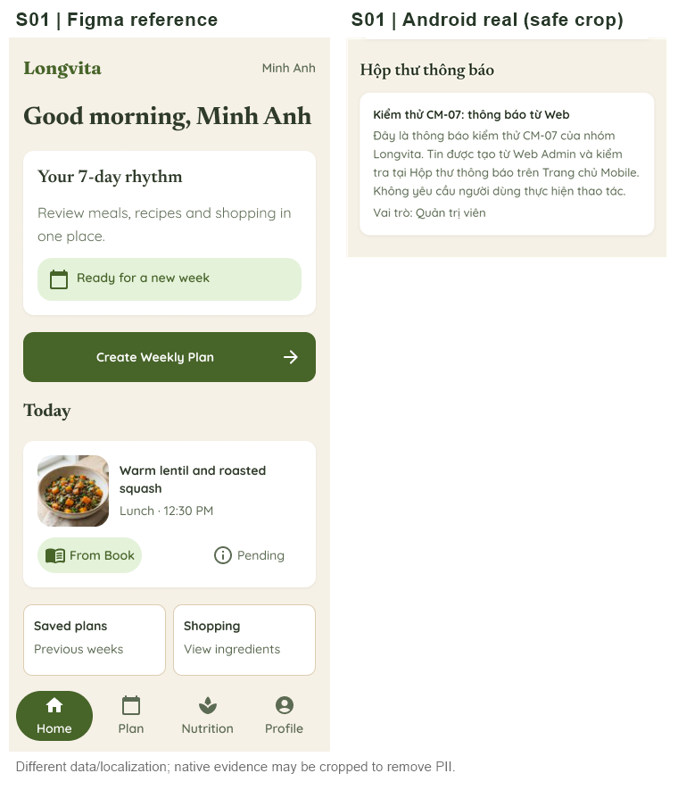
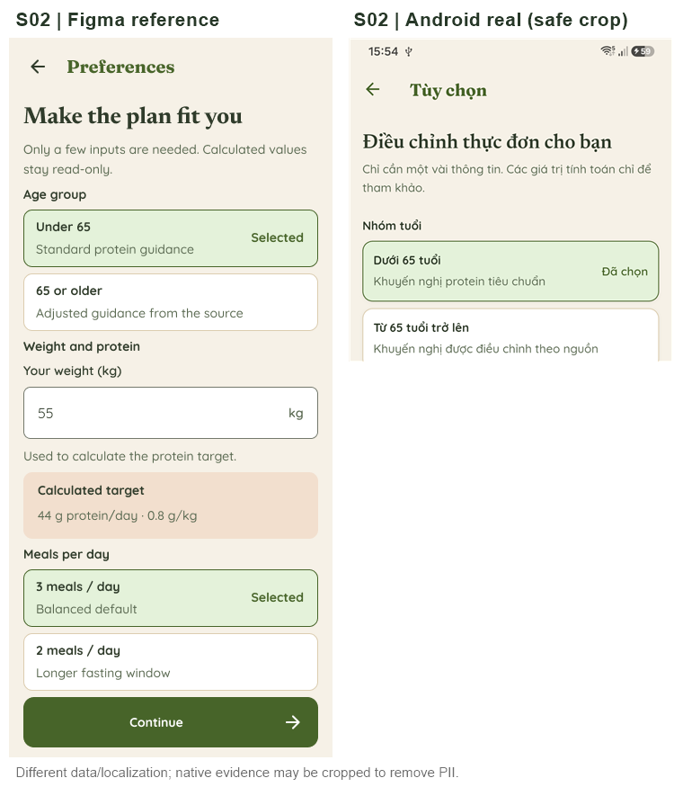
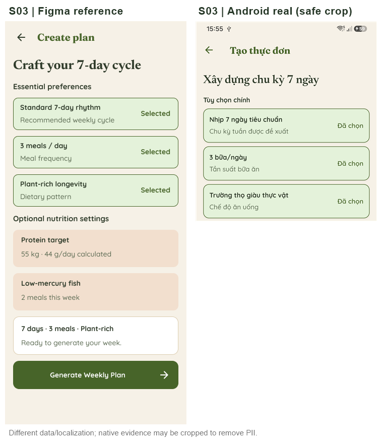
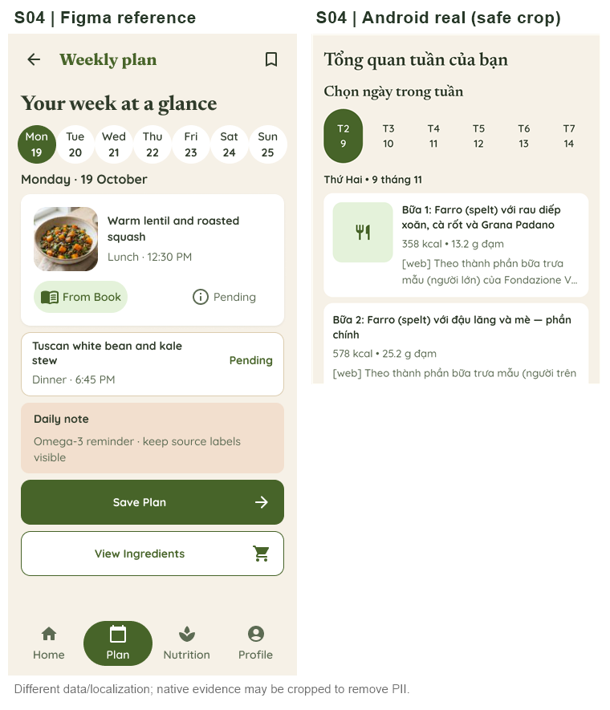
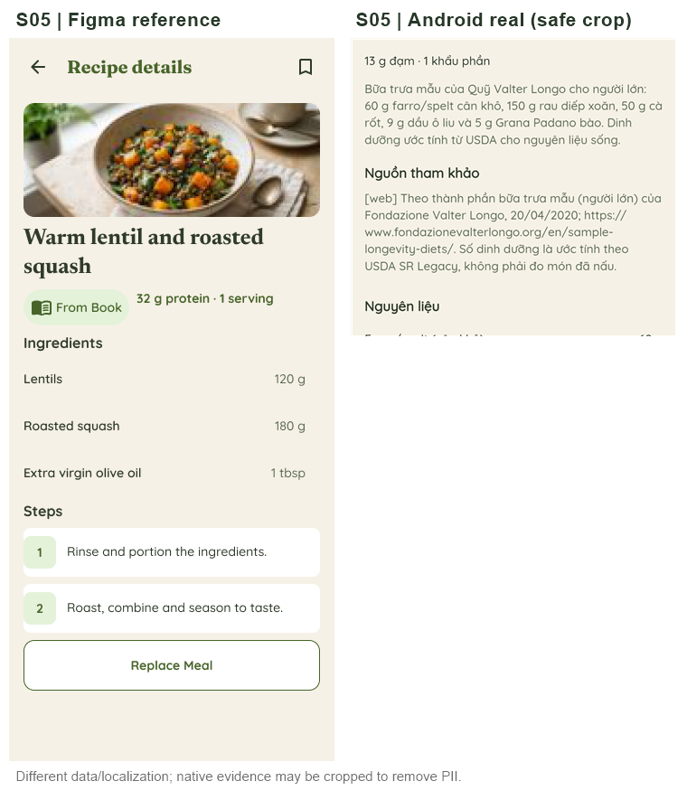
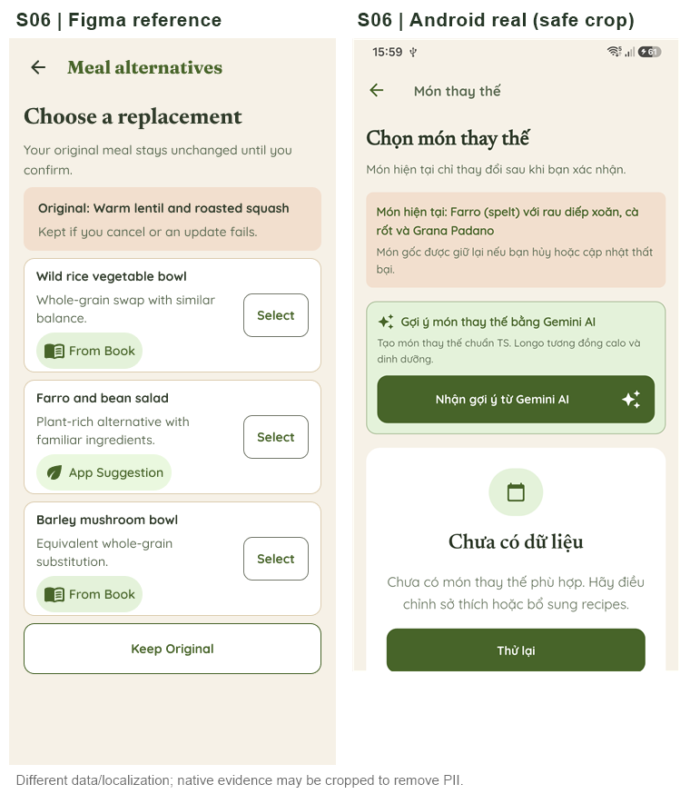
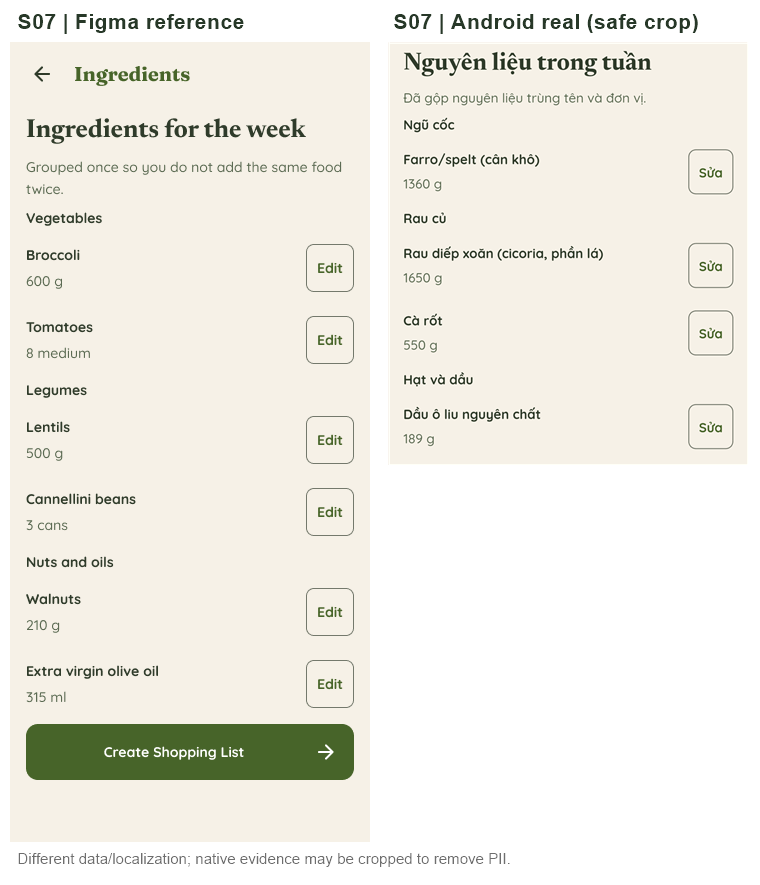
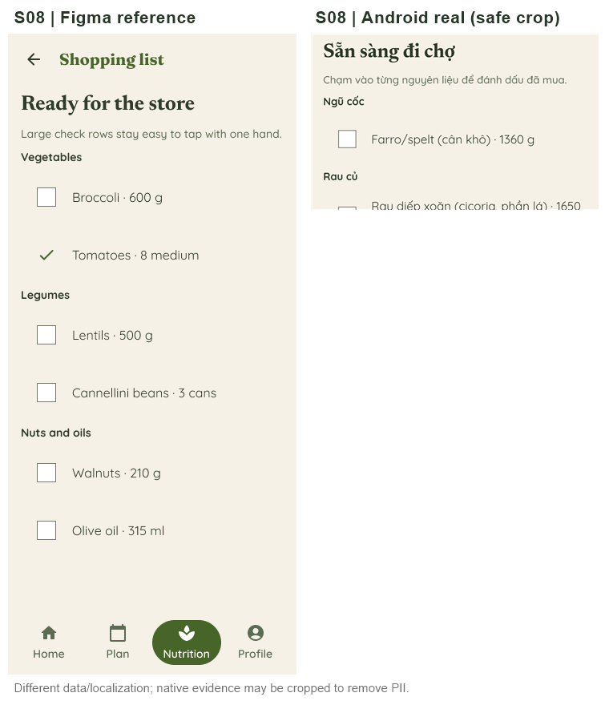
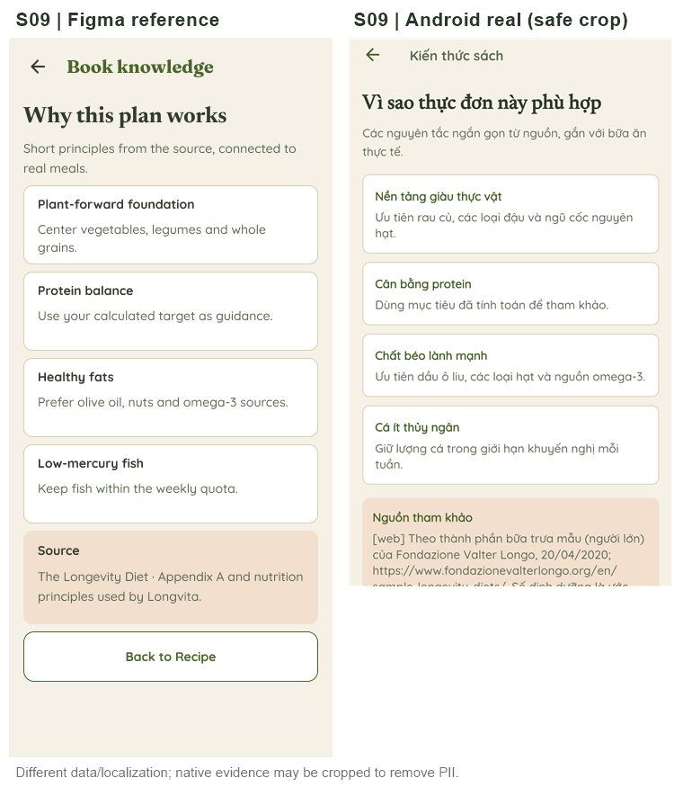
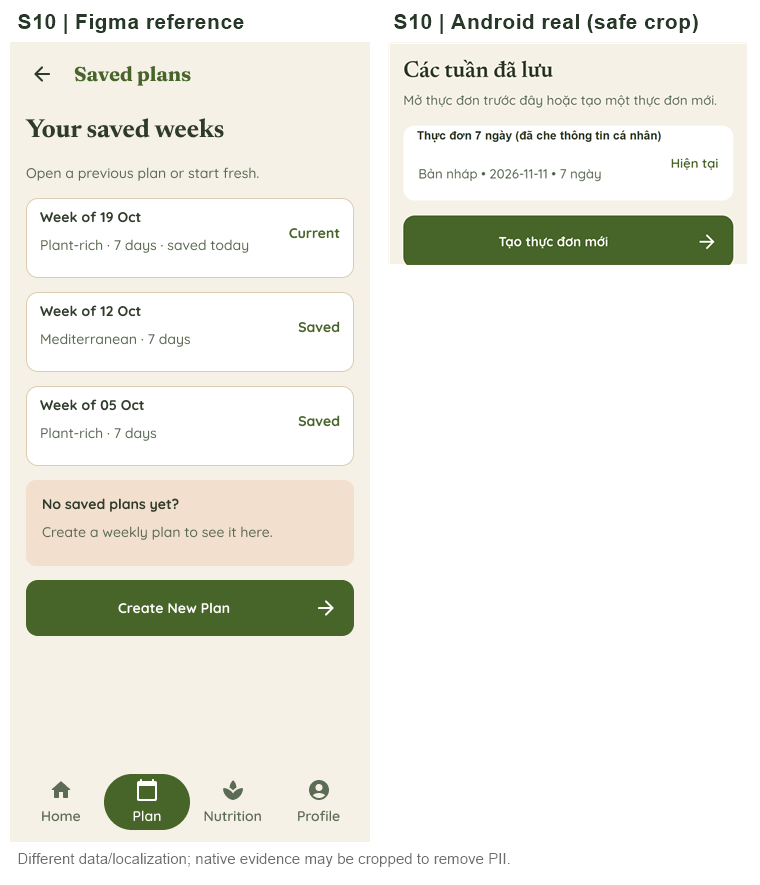

# Đối chiếu 10 màn Longvita: Figma 03 Final UI ↔ Samsung A15

**Ngày:** 11/11/2026. **Cơ sở Git:** main f0d02f0 (sau merge PR #43 và #44). **Figma:** https://www.figma.com/design/73GTcipwH825N7l501or8D ; trang 03 Final UI.

**Phương pháp:** dùng get_metadata/get_screenshot từ cùng file Figma, đọc 10 frame thiết kế 360x800 và ghép với ảnh Android thật đã khử PII trong PR #43. Ảnh 1080 px được thu nhỏ về 360 px để so bố cục theo chiều ngang; Android crop khác vị trí cuộn, dữ liệu, trạng thái và ngôn ngữ. **Đây là đối chiếu cấu trúc có điều kiện, KHÔNG phải phép đo pixel-perfect, không phải 10/10 màn đạt thị giác toàn phần.**

## Ma trận theo màn

| Màn | Node Figma | Mức bằng chứng | Nhận xét / phép thử còn thiếu |
| --- | --- | --- | --- |
| S01 · Trang chủ | [103:5](https://www.figma.com/design/73GTcipwH825N7l501or8D?node-id=103-5) | Chưa đủ ảnh | Ảnh native chỉ chụp phần thông báo CM-07, không có header, CTA và navbar đầy đủ. Không thể kết luận độ khớp tổng thể S01. |
| S02 · Tùy chọn | [103:83](https://www.figma.com/design/73GTcipwH825N7l501or8D?node-id=103-83) | Khớp phần đã thấy | Nhóm tuổi và các thẻ chọn có cùng cấu trúc, màu/kiểu chữ tương đương sau Việt hóa. Ảnh native chỉ phần trên; cân nặng và nút tiếp tục chưa đối chiếu được bằng cặp ảnh này. |
| S03 · Tạo thực đơn | [103:125](https://www.figma.com/design/73GTcipwH825N7l501or8D?node-id=103-125) | Khớp phần đã thấy | Ba tùy chọn nền và dấu Đã chọn tương ứng Figma. Ảnh native chưa gồm phần ghi chú dinh dưỡng và nút tạo; chưa kết luận full viewport. |
| S04 · Thực đơn tuần | [103:160](https://www.figma.com/design/73GTcipwH825N7l501or8D?node-id=103-160) | Cần xem thêm vùng cuộn | Thứ/ngày, thẻ món, calo/đạm và nguồn hiện rõ với dữ liệu thật. Layout thay đổi do số món và chuỗi nguồn dài. Cần xác nhận ngày thứ bảy của carousel, CTA cuối trang và overflow ở 200% chữ. |
| S05 · Chi tiết công thức | [108:244](https://www.figma.com/design/73GTcipwH825N7l501or8D?node-id=108-244) | Chưa đủ ảnh | Ảnh native cắt ở phần nội dung nguồn tham khảo/nguyên liệu; Figma minh họa ảnh hero có dữ liệu mẫu. Không đủ ảnh để xác nhận hero/fallback khi imageUrl=null hay bố cục toàn màn. |
| S06 · Thay món | [108:285](https://www.figma.com/design/73GTcipwH825N7l501or8D?node-id=108-285) | Khác trạng thái dữ liệu | Figma minh họa danh sách 3 món khả dụng; máy thật không có món thay thế nên hiện Empty/Retry và gợi ý AI. Nhánh Empty/Retry và quay về S02 đã thử; cần thử nhánh lựa chọn thành công và xin duyệt khối AI thêm so với Figma. |
| S07 · Nguyên liệu | [106:189](https://www.figma.com/design/73GTcipwH825N7l501or8D?node-id=106-189) | Tương đồng phần đã thấy | Nhóm nguyên liệu, tên, số lượng và nút sửa tương đồng Figma. Dữ liệu thật nhiều hơn mẫu nên CTA nằm cuối trang cuộn; cần ảnh toàn chiều dài và đối chiếu 48dp/200% chữ. |
| S08 · Đi chợ | [106:235](https://www.figma.com/design/73GTcipwH825N7l501or8D?node-id=106-235) | Tương đồng phần đã thấy | Checkbox và nhóm nguyên liệu phù hợp mẫu, số lượng thực tế khác. Đã thử giữ/bỏ trạng thái khi mở lại. Ảnh crop chưa hiển thị trọn nav và danh sách dài. |
| S09 · Kiến thức sách | [108:332](https://www.figma.com/design/73GTcipwH825N7l501or8D?node-id=108-332) | Tương đồng cao phần đã thấy | Tiêu đề, 4 thẻ nguyên tắc, khung nguồn màu kem tương đồng Figma sau Việt hóa. Nguồn thật dài hơn mẫu nên cuộn; cần ảnh cuối trang và đọc bằng TalkBack. |
| S10 · Thực đơn đã lưu | [103:269](https://www.figma.com/design/73GTcipwH825N7l501or8D?node-id=103-269) | Tương đồng phần đã thấy | Thẻ bản nháp 7 ngày, nhãn Hiện tại và CTA tạo mới tương đương mẫu. Figma có 3 kế hoạch ví dụ, tài khoản thật chỉ có 1 kế hoạch; ảnh native đã che cân nặng và crop navbar. |

## Những phát hiện chính

1. **S09** có mức tương đồng bố cục dễ quan sát nhất: bốn thẻ nguyên tắc và vùng nguồn màu khác biệt khớp thứ tự Figma; nội dung nguồn thực tế dài hơn, do đó cần cuộn và test text scaling/TalkBack.
2. **S06** khác trạng thái mẫu. Màn rỗng trên máy thật là một state nghiệp vụ hợp lệ và đã có Thử lại + hướng quay về S02, nhưng chưa thể dùng để nghiệm thu giao diện danh sách 3 phương án thay thế trong Figma. Gợi ý Gemini là khối thêm, cần phê duyệt sản phẩm.
3. **S07/S08** tương đồng theo cấu trúc, nhưng có nhiều dữ liệu hơn Figma nên phần CTA hoặc navbar không có trong ảnh crop. Chỉnh 1360→1361→1360, từ chối 0 và checkbox persistence đã có bằng chứng native riêng.
4. **S01/S02/S03/S05/S10** thiếu ảnh native full viewport không chứa PII để kết luận cả màn hình. Không xem phần bị che/crop là đạt.
5. **Nguồn/định lượng:** không thể xác nhận độ chính xác khoa học hoặc quyền công bố từ ảnh UI. Bộ 29 món có gate review và chưa được tự động xuất bản.

## Yêu cầu để ký nghiệm thu hình ảnh 100%

- Chụp đủ 10 màn với cùng một trạng thái dữ liệu và cùng tỉ lệ 360 logical dp, có mask PII thay vì cắt mất phần cần so.
- Chụp thêm scroll-bottom đối với S04/S05/S07/S08/S09/S10, kiểm tra 7 ngày điều hướng được, footer/CTA không bị chặn, text 200% và Semantics/TalkBack.
- S06 cần cả Empty/Retry và trạng thái có >=1 món thay thế thực, thử chọn và quay về giữ dữ liệu; không tạo recipe giả để làm đẹp ảnh.
- Review riêng khối Gemini bổ sung ở S05/S06 và xử lý ảnh hero khi công thức không có imageUrl.
- Cần người phụ trách thiết kế duyệt sai lệch có chủ đích về tiếng Việt, nguồn dài, danh sách động, rồi ghi trạng thái accepted/needs-fix kèm ảnh final.
- ARTEMIS 3 lượt/test, Web Staff cross-role live, Firebase Console và kiểm định dinh dưỡng là gate khác; không được lấy Figma compare thay thế.

## Cặp ảnh đối chiếu

### S01: Trang chủ

### S02: Tùy chọn

### S03: Tạo thực đơn

### S04: Thực đơn tuần

### S05: Chi tiết công thức

### S06: Thay món

### S07: Nguyên liệu

### S08: Đi chợ

### S09: Kiến thức sách

### S10: Thực đơn đã lưu

