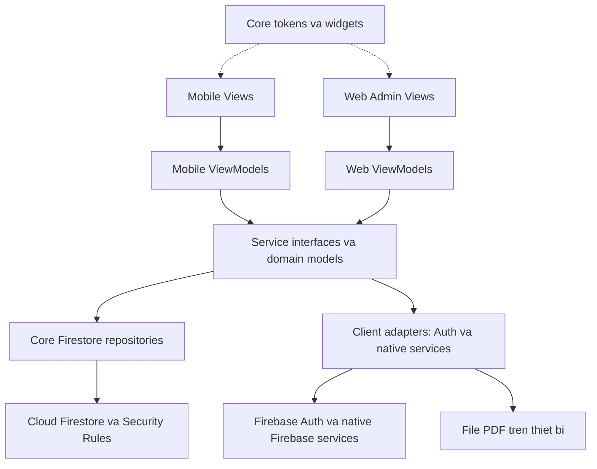
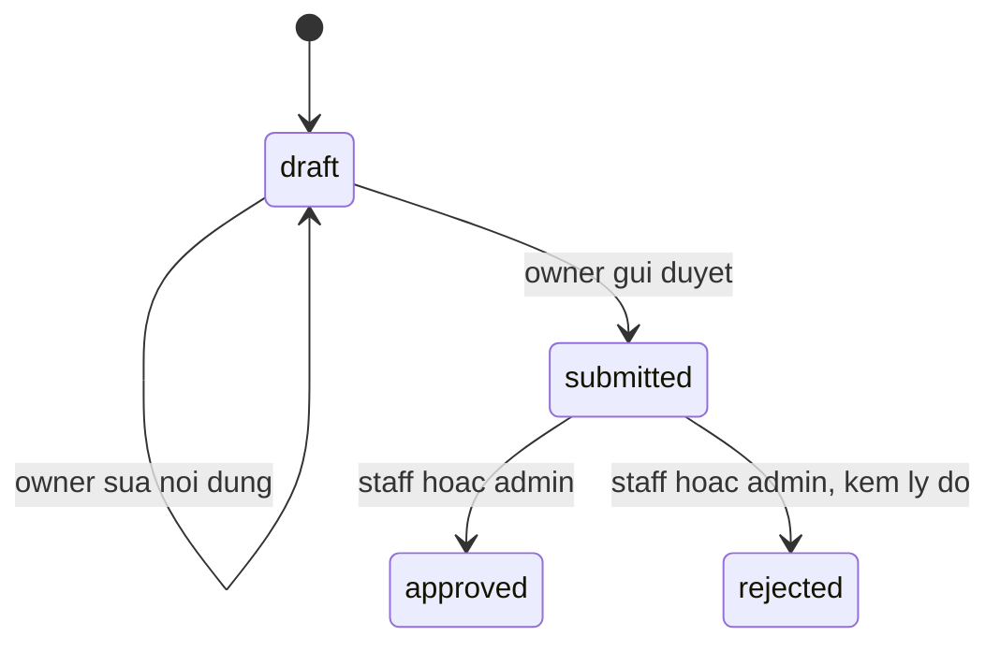

# Đóng góp báo cáo Final — Charlie Minh (CM-08)

**Bản nháp cho Chương 2, Chương 3 và phần Charlie của Chương 9.** Đối chiếu source `aaae57d` và bằng chứng đến ngày **11/11/2026**. Thắng tổng hợp vào Final PDF 10–15 trang; tài liệu này không thay thế báo cáo kiểm thử toàn nhóm. Phạm vi theo [phân công CM-08 và 9 chương](tasks/final-task-assignment.md).

## Chương 2. Kiến trúc Monorepo và Shared Core

### 2.1. Kế thừa Lab 2, mở rộng từ Lab 3

Longvita kế thừa các luồng thực đơn, nguyên liệu, mua sắm và thiết kế mẫu của Lab 2. Lab 3 hiện thực Mobile với Firebase; Final bổ sung Web Admin và phần dùng chung trong cùng repository. Figma là tham chiếu thiết kế; việc cải thiện UI thực hiện trong code. Tokens, font và common widgets nằm ở Core để hai client dùng chung; không nhân đôi một bộ giao diện cho mỗi client. [Nguồn: migration và design system](monorepo-migration.md).

```text
pubspec.yaml / pubspec.lock       Workspace, một lockfile
mobile/lib/                      Views, ViewModels, Auth và native adapters
web/lib/                         Admin views, ViewModels, Web Auth/role gate
packages/core/lib/
  models/                        Domain, serialization, state models
  services/                      Interfaces, Firestore services/repositories
  firebase/                      Analytics, Remote Config
  theme/  widgets/  l10n/         Tokens, UI dùng chung, tiếng Việt
firebase/                        Security Rules và Emulator tests
evidence/                        Bằng chứng theo từng gói triển khai
```

Hướng phụ thuộc là **Mobile → Core ← Web**. Core là Flutter package có Firestore services và widgets, không phải package Dart thuần. PDF/file system, Google Sign-In native, FCM và Crashlytics ở Mobile; Web có auth gateway riêng. Root [workspace](../pubspec.yaml) và [Core package](../packages/core/pubspec.yaml) khai báo ranh giới này. Checker phát hiện import sai boundary; [evidence CM-00/CM-02](../evidence/architecture/CM-00-CM-02-20261110/README.md) ghi migration, bundle font, build hai client và các kiểm tra không làm mất source.

### 2.2. Các lớp MVVM và dependency injection



View hiển thị trạng thái và chuyển thao tác sang ViewModel; service/repository thực hiện truy vấn và serialize model. `mobile/lib/main.dart` tạo dependency sau bootstrap Firebase, inject qua constructor và Provider. Web làm tương tự tại `web/lib/main.dart`, sử dụng `IAdminService`, `IAnnouncementPublisher` và auth gateway của Web. Các entrypoint là nơi ghép implementation, không phải logic truy vấn đặt trong UI. [Mobile wiring](../mobile/lib/main.dart), [Web wiring](../web/lib/main.dart).

Mobile dùng `ViewState<T>` cho idle/loading/success/empty/error; Web dùng `AdminLoadState` và các phase Auth riêng. Hai client chia sẻ nguyên tắc state rõ ràng, không phải mọi ViewModel dùng cùng một enum. Khi đổi phiên, generation/request guard bỏ kết quả muộn của phiên cũ; điều đó không đồng nghĩa hủy request SDK đã gửi. [State model](../packages/core/lib/models/view_state.dart), [Web ViewModels](../web/lib/admin/admin_viewmodels.dart), [Web Auth ViewModel](../web/lib/admin/admin_auth_viewmodel.dart).

### 2.3. Hai luồng minh họa ranh giới hệ thống

- **PDF Final No-Cost:** Profile lấy đúng kế hoạch đang chọn, dựng và lưu PDF trên thiết bị; repository riêng ghi metadata Firestore. File dùng được khi metadata đang chờ mạng; quá 15 giây UI báo đang chờ đồng bộ và tiếp tục theo dõi cùng request. Bản Final mặc định không tạo Storage service. Chế độ Storage chỉ dành cho demo Emulator với cấu hình host hợp lệ. [Contract PDF](pdf-export-contract.md), [cấu hình chế độ](../mobile/lib/config/pdf_export_mode.dart), [kiểm native Spark/online/offline](../evidence/firebase/NC-05-final-no-cost-20261109/README.md).
- **Thông báo quản trị:** Web form → `IAnnouncementPublisher` → transaction ghi `announcements` → stream Firestore → hộp thư Home Mobile. Transaction đọc role thực, giữ cùng ID/payload khi retry trong phiên và không ghi đè nội dung khác. Đây là luồng Firestore, khác thông báo FCM trên Profile. Đã có một lượt Web → Firestore → Mobile thật trong CM-07; không thay bằng chứng ba lượt cross-role xét duyệt của TV-04. [Publisher](../packages/core/lib/services/firestore_announcement_publisher.dart), [evidence CM-07](../evidence/web/CM-07-20261110/README.md).

## Chương 3. Data Model và Security Rules

### 3.1. Schema dùng chung — tóm tắt Appendix A

Model và rules dùng cùng tên field; ID document thường lấy từ đường dẫn. Bảng chi tiết trường, CRUD và màn hình sử dụng ở [Data model Appendix A](data-model.md). Các đường dẫn nguồn cũ `lib/models/` trong tài liệu đó được đối chiếu với [models tại Core](../packages/core/lib/models/).

| Đường dẫn | Trường chính và kiểu | Màn hình sử dụng |
| --- | --- | --- |
| `users/{uid}` | `email`, `displayName`, `role`, `createdAt`: string; `photoUrl`: string/null, optional | Mobile Sign-in/Profile; Web role gate |
| `recipes/{id}` | `name`, `description`, `category`, `sourceNote`: string; `calories`, `proteinGrams`: number; `ingredients`, `instructions`: list; `imageUrl`: string/null; `isArchived`: bool optional | Mobile danh mục/tạo/đổi món; Web Công thức/Dashboard |
| `meal_plans/{id}` | `uid`, `title`, `status`, `createdAt`: string; `targetCalories`, `targetProteinGrams`: number; `days`: list; `reviewerReason`: string/null optional | Mobile thực đơn đã lưu; Web Xét duyệt/Dashboard |
| `shopping_lists/{uid}/plans/{planId}` | `uid`, `planId`, `updatedAt`: string; `items`: list | Mobile Nguyên liệu/Mua sắm |
| `users/{uid}/report_exports/{exportId}` | `exportId`, `createdAt`, `fileName`: string; `planId`: string/null; `sizeBytes`, `schemaVersion`: int | Profile, trạng thái metadata PDF |
| `announcements/{id}` | `title`, `content`, `authorRole`, `createdAt`: string | Web AnnouncementForm; Mobile Home Inbox |

Thời gian hiện được serialize thành chuỗi ISO-8601; riêng metadata PDF còn kiểm định dạng UTC có `Z`. Đây không phải timestamp do server cấp. Metadata chỉ gồm sáu field, không chứa nội dung PDF, email hay URL Storage; tên file/ID export không ghép UID. `sizeBytes` phải trong 1…10.485.760 byte, `schemaVersion = 1`; plan đã lưu phải thuộc owner khi tạo metadata. Retry chỉ nhận payload giống hệt. [Rules metadata](../firebase/firestore.rules), [repository](../packages/core/lib/services/firestore_report_metadata_repository.dart).

### 3.2. Quyền đọc, ghi và bảo vệ dữ liệu

Mọi đường dẫn không được cấp quyền cụ thể đều bị từ chối. Rules lấy role từ `users/{request.auth.uid}.role`, không tin role do client tự khai báo. Quyền project Firebase/Google Cloud khác role ứng dụng: Owner project không tự được Web cho vào nếu hồ sơ chưa có role phù hợp. [Rules triển khai](../firebase/firestore.rules).

| Entity | Đọc | Tạo, cập nhật, xóa |
| --- | --- | --- |
| Hồ sơ | Chính chủ hoặc admin | Chính chủ tạo role `user`, sửa tên/ảnh; admin chỉ đổi role người khác; cấm xóa bằng client |
| Công thức | Người đã đăng nhập | Staff/admin tạo, sửa, archive/restore; cấm xóa cứng |
| Thực đơn | Owner hoặc staff/admin | Người đăng nhập tạo draft cho chính UID; owner sửa/gửi/xóa khi draft; staff/admin xét duyệt submitted |
| Shopping list | Chỉ owner | Chỉ owner; UID và planId phải khớp đường dẫn |
| Metadata PDF | Chỉ owner, kể cả admin UID khác cũng bị chặn | Owner tạo; cập nhật chỉ cùng payload; cấm xóa |
| Thông báo | Người đã đăng nhập | Staff/admin tạo/sửa với `authorRole` khớp role thật; sửa chỉ title/content; staff/admin được xóa |

Admin đầu tiên là Charlie, được bootstrap qua Console theo [README](../README.md). Client không thể tự tạo admin, tự nâng role hoặc admin tự đổi role mình. Ngày 10/11 đã tạo user demo bằng Google sign-in Mobile thật, sau đó cấp staff cho tài khoản riêng theo xác nhận của nhóm. Snapshot sau cấp quyền là **3 admin / 1 staff / 1 user**. Thao tác quản trị qua Owner OAuth bỏ qua rules; nó không được dùng làm bằng chứng client admin đổi role thành công.

Validator giới hạn title recipe/plan và announcement title ở 120 ký tự; announcement content 2000; số dinh dưỡng không âm; ingredients ≤50, instructions ≤30, shopping items ≤500. `hasAll`/`hasOnly` kiểm field; `diff().affectedKeys()` giới hạn field được đổi. Validator `authorRole` áp dụng cả lúc sửa thông báo, nên editor phải có cùng role với `authorRole` của document. Quyền đọc hồ sơ cha không tự lan xuống subcollection metadata. Staff dashboard đếm recipes/plans, không query toàn bộ users. [Rules](../firebase/firestore.rules), [AdminService](../packages/core/lib/services/admin_service.dart).

### 3.3. Chuyển trạng thái thực đơn



Source dùng **`submitted`**, không dùng `pending` trong một số mô tả task cũ. Ngoài draft, thực đơn phải đủ đúng 7 ngày. Tài khoản role `user` không có quyền duyệt; reviewer chỉ đổi status/reason, không thay món hay UID. Rules hiện không yêu cầu UID reviewer khác UID owner, nên không khẳng định staff/admin bị chặn xét duyệt plan của chính mình. Rejected phải có lý do; approved/rejected là trạng thái cuối của document. Client hiện yêu cầu đủ 7 ngày ngay khi lưu, chặt hơn mức draft tối đa 7 ngày trong rules. [State contract](data-model.md), [DataService](../packages/core/lib/services/data_service.dart), [ReviewQueueItem](../packages/core/lib/models/review_queue_item.dart).

### 3.4. Bằng chứng kiểm thử và triển khai

| Bằng chứng | Kết quả và phạm vi |
| --- | --- |
| [CM-04 — matrix và ca biên](../evidence/rules/CM-04-20261109/README.md) | 42 ca R-01…R-42; thêm một coverage check thành 43 test. Bộ cũ chỉ đạt 37/42 ca, lệch đúng R-05/11/12/14/42 |
| [Log Firestore canonical](../evidence/web/CM-07-20261110/rules.txt) | **103/103** trên Emulator, gồm matrix và ca biên. 42 ca đã nằm trong tổng, không cộng thêm lần nữa |
| [Kết quả CM-04 ban đầu](../evidence/rules/CM-04-20261109/README.md) | **117 = 103 Firestore + 14 Storage Emulator**. Storage Emulator không chứng minh upload cloud |
| [Rollout ngày 11/11](../evidence/firebase/CM-03-rollout-20261111/README.md) | CLI compile/upload/release thành công lúc **00:02:54 VN**; active source đọc lại khớp từng byte deployment target và khớp canonical rules trên main sau chuẩn hóa CRLF/LF |
| [Kiểm client sau rollout](../evidence/firebase/CM-03-rollout-20261111/staff-dashboard-after.png) | Staff vào Web; Dashboard có 2 công thức hoạt động, 0 thực đơn chờ duyệt, 0 đã duyệt; đọc 2 công thức và mở queue trống không lỗi quyền; không ghi dữ liệu nghiệp vụ |

Rollout chỉ deploy Firestore rules cho `longvita-8da7e`, database `(default)`. Nguồn `aaae57d`, rules git blob `2c382be45b9ed55e0df40f6d01ba1b07230d00c1`; ruleset active khi kiểm là `7eb64fde-6ba7-461f-81c2-707a9ae2eb10`. [Verification và source readback](../evidence/firebase/CM-03-rollout-20261111/verification.json) lưu hash, thời gian và phạm vi. Role giữ nguyên; không deploy Hosting/Storage hoặc đổi billing. Snapshot phục hồi có lưu riêng; tài liệu chia sẻ không kèm dữ liệu tài khoản hay credential.

### 3.5. Giới hạn cần giữ khi tổng hợp Final

- Rules kiểm loại list và số phần tử, chưa kiểm toàn bộ cấu trúc từng phần tử lồng nhau. Recipe archive vẫn đọc được khi đã đăng nhập; Mobile lọc khỏi gợi ý mới nhưng giữ mở món của plan cũ. [Validator và truy vấn](../packages/core/lib/services/data_service.dart).
- Web đã có role gate staff/admin. **Mobile gate `role == user` (HD-03B) chưa có trong baseline này**; rules tạo draft dựa trên UID, chưa bắt buộc role user. Không ghi rằng Mobile đã từ chối staff/admin. [Web gate](../web/lib/admin/admin_auth.dart), [Mobile gate](../mobile/lib/screens/auth_gate.dart), [rules create plan](../firebase/firestore.rules).
- Suite allow/deny đầy đủ chạy trên Emulator; kiểm production sau rollout mới gồm source readback và staff read smoke. Chưa chạy đầy đủ negative/write matrix trên production. UI/SDK cache không thay thế kiểm rules phía server.
- Final giữ Spark, PDF local + metadata; Storage cloud ngoài phạm vi theo quyết định nhóm, không phải một luồng upload đã đạt. Hosting có UI đang live, nhưng rollout rules không chứng minh đã deploy Web CM-07. Ba lượt cross-role live và phần AI do owner tương ứng cung cấp; chương này không tự nhận các kết quả đó. [No-Cost evidence](../evidence/firebase/NC-05-final-no-cost-20261109/README.md), [CM-07 scope](../evidence/web/CM-07-20261110/verification.json).

## Đóng góp Chương 9. Bài học kinh nghiệm

- **Tách Core theo khả năng chạy trên hai client:** chia sẻ model, Firestore, tokens/widgets; giữ native adapters ở Mobile. Một lockfile và checker boundary giúp đổi cấu trúc mà giữ hợp đồng dữ liệu. [CM-00/02](../evidence/architecture/CM-00-CM-02-20261110/README.md).
- **Phân quyền project và ứng dụng giải quyết hai việc khác nhau:** role gate dựa hồ sơ server; kiểm bằng Owner OAuth có thể đọc/ghi quản trị nhưng không chứng minh rules cho phép client. Cần tài khoản demo riêng theo role. [Role gate](../web/lib/admin/admin_auth.dart), [matrix](../evidence/rules/CM-04-20261109/matrix-results.json).
- **Async cần gắn với phiên và ý định thao tác:** bỏ kết quả muộn không phải hủy request; retry metadata/thông báo phải giữ ID/payload và đợi server xác nhận. Không phát Analytics trong callback transaction có thể bị SDK chạy lại. [Metadata repository](../packages/core/lib/services/firestore_report_metadata_repository.dart), [publisher](../packages/core/lib/services/firestore_announcement_publisher.dart).
- **Merge source chưa đồng nghĩa triển khai:** rules đúng trên main từng khác bản server. Snapshot, so hash, deploy đúng phạm vi và readback giúp đóng khoảng cách đó; deploy rules cũng không đồng nghĩa deploy Hosting. [Rollout](../evidence/firebase/CM-03-rollout-20261111/README.md).
- **Bằng chứng cần ghi đúng môi trường và giới hạn:** unit/widget, Emulator và client thật trả lời các câu hỏi khác nhau. Log phải giữ cả lượt fail, không cộng trùng matrix và không gọi Storage Emulator là cloud. [CM-04](../evidence/rules/CM-04-20261109/README.md), [CM-07](../evidence/web/CM-07-20261110/README.md).
