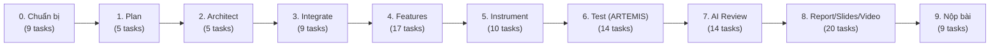

# Kế Hoạch Task & Điều Phối Dự Án — PRM393 Lab 3

> **Dự án:** Longvita — Cloud-Enabled Mobile App (Dinh dưỡng trường thọ)  
> **Công nghệ:** Flutter + Firebase + Google ARTEMIS + AI Code Review  
> **Hình thức làm bài:** Nhóm 4 người (*Handout ghi “Individual”, cần giảng viên xác nhận tại task S0-1*)  
> **Tổng số task:** 112 tasks | **Tiến độ đã đồng bộ:** 12/112 (11%)

---

## 1. Phân Công Vai Trò & Tiến Độ Thành Viên

| Thành viên | Tài khoản / MSSV | Vai trò chính trong Lab 3 | Tổng task | Đã xong | Tiến độ | File task cá nhân |
|:---|:---|:---|:---:|:---:|:---:|:---|
| **Thái An** | Thái An | **Team Leader & QA Lead**: Điều phối chung, Analytics, Crashlytics, Remote Config, ARTEMIS | 29 | 7 | 24% | [`task-thai-an.md`](task-thai-an.md) |
| **Charlie** | CharlieMinh | **Design System in Code + Firebase**: Auth, Storage, FCM, Common Widgets, Profile | 29 | 0 | 0% | [`task-charlie.md`](task-charlie.md) |
| **Hoàng** | Hoàng DV (YAHsaveme) | **Dữ liệu & UI Flows**: DataService, 3 Flows (S01–S10), States, A11y, Sync Figma | 26 | 0 | 0% | [`task-hoang.md`](task-hoang.md) |
| **Thắng** | Thắng VLQ | **Technical Architect & Co-Lead**: MVVM Skeleton, Router, Docs, Report, Slides, Video | 28 | 5 | 18% | [`task-thang.md`](task-thang.md) |
| **TỔNG CỘNG** | | | **112** | **12** | **11%** | |

---

## 2. Tiến Độ Theo Giai Đoạn (Workflow 10 Bước)

Quy trình phát triển tuân thủ nghiêm ngặt theo thứ tự handout mục 4: *Plan → Architect → Integrate → Features → Instrument → Test → Review → Report → Nộp bài*.

| Giai đoạn | Tổng task | Chưa bắt đầu | Đang làm | Bị chặn | Đã xong | Tỷ lệ |
|:---|:---:|:---:|:---:|:---:|:---:|:---:|
| 0. Chuẩn bị | 9 | 7 | 0 | 1 | 1 | 11% |
| 1. Plan | 5 | 3 | 0 | 0 | 2 | 40% |
| 2. Architect | 5 | 2 | 0 | 0 | 3 | 60% |
| 3. Integrate | 9 | 7 | 1 | 0 | 1 | 11% |
| 4. Features | 17 | 17 | 0 | 0 | 0 | 0% |
| 5. Instrument | 10 | 5 | 0 | 0 | 5 | 50% |
| 6. Test (Google ARTEMIS) | 14 | 14 | 0 | 0 | 0 | 0% |
| 7. AI Code Review | 14 | 14 | 0 | 0 | 0 | 0% |
| 8. Báo cáo, Slide, Video | 20 | 19 | 1 | 0 | 0 | 0% |
| 9. Kiểm tra & Nộp bài | 9 | 9 | 0 | 0 | 0 | 0% |
| **TỔNG** | **112** | **97** | **2** | **1** | **12** | **11%** |

---

## 3. Kế Hoạch 4 Tuần

- **Tuần 1 (17 tasks):** Thiết lập môi trường, chốt nhóm/chủ đề, viết `design-traceability.md`, thiết kế bổ sung Sign-in/Profile, chốt interface service, dựng theme và skeleton.
- **Tuần 2 (17 tasks):** Firebase Auth, Storage rules, Remote Config defaults, 9 common widgets, DataService, Flow 1 chạy end-to-end.
- **Tuần 3 (29 tasks):** Flow 2 (S07-S08), Flow 3 (S05-S06-S09), PDF export/upload, FCM, Analytics logging, Crashlytics, Feature Freeze.
- **Tuần 4 (49 tasks):** Chạy ARTEMIS E2E (>=3 runs/test, exploratory), AI Code Review trên PR, viết Report (8-12 trang), Slides (12-15 trang), quay Demo Video (5-10 phút), kiểm tra nộp bài.

---

## 4. Các Mốc Quan Trọng (Milestones M1–M9)

| Mốc | Tên mốc | Điều kiện hoàn thành | Người chịu trách nhiệm | Tuần | Trạng thái |
|:---:|:---|:---|:---|:---:|:---:|
| **M1** | Nền móng | Traceability, interface service, theme, khung lib/ đã xong; repo, Firebase project, tài khoản test sẵn sàng | Thắng | 1 | ⏳ Chưa đạt |
| **M2** | Đăng nhập chạy | Google Sign-In, routing theo auth state, storage.rules, widget dùng chung đã xong | Charlie | 2 | ⏳ Chưa đạt |
| **M3** | Flow đầu tiên | Flow 1 chạy end-to-end với dữ liệu thật; `analytics-plan.md` đã chốt | Hoàng | 2 | ⏳ Chưa đạt |
| **M4** | Tính năng đầy đủ | Mọi flow, export + upload, FCM, Remote Config, Crashlytics, analytics hoạt động | Thắng | 3 | ⏳ Chưa đạt |
| **M5** | Feature freeze | Tag bản build ổn định; từ đây chỉ sửa bug, không thêm tính năng | Thắng | 3 | ⏳ Chưa đạt |
| **M6** | ARTEMIS hoàn tất | $\ge 10$ test cases, mỗi test $\ge 3$ lần, bảng pass rate, phiên exploratory xong | Thái An | 4 | ⏳ Chưa đạt |
| **M7** | Code review xong | $\ge 5$ findings, $\ge 3$ commit fix liên kết, `code-review.md` hoàn chỉnh | Thắng | 4 | ⏳ Chưa đạt |
| **M8** | Báo cáo, Slide, Video | Ba file/link hoàn chỉnh, mở được bằng trình duyệt ẩn danh | Thắng | 4 | ⏳ Chưa đạt |
| **M9** | Nộp bài | Kiểm tra cuối đạt; nộp link repo, report PDF, slides PDF, demo video link | Thắng | 4 | ⏳ Chưa đạt |

Chi tiết phụ thuộc và đường găng: xem [`milestones-and-dependencies.md`](milestones-and-dependencies.md).

---

## 5. Danh Mục Tài Liệu Task & Document

1. **Danh sách task chi tiết:**
   - [`danh-sach-task-full.md`](danh-sach-task-full.md) — Toàn bộ 112 tasks từ file Excel.
   - [`task-thai-an.md`](task-thai-an.md) — 29 tasks của Thái An.
   - [`task-charlie.md`](task-charlie.md) — 29 tasks của Charlie.
   - [`task-hoang.md`](task-hoang.md) — 26 tasks của Hoàng.
   - [`task-thang.md`](task-thang.md) — 28 tasks của Thắng.
2. **Kiểm soát chất lượng & nộp bài:**
   - [`milestones-and-dependencies.md`](milestones-and-dependencies.md) — Mốc M1–M9 và phân tích đường găng.
   - [`submission-checklist.md`](submission-checklist.md) — Bảng kiểm 14 tiêu chí nộp bài bắt buộc từ Handout.
3. **5 Document chính của Lab 3 (trong thư mục `docs/`):**
   - [`../design-traceability.md`](../design-traceability.md) — Ma trận truy vết thiết kế Lab 2 $\to$ Flutter & Deviation log.
   - [`../architecture.md`](../architecture.md) — Tài liệu kiến trúc MVVM, Mermaid layer diagram, Sequence diagram, Service mapping.
   - [`../analytics-plan.md`](../analytics-plan.md) — Kế hoạch đo lường $\ge 7$ sự kiện Firebase Analytics (Appendix A).
   - [`../test-plan.md`](../test-plan.md) — Kế hoạch kiểm thử $\ge 10$ test cases E2E Google ARTEMIS (Appendix B).
   - [`../code-review.md`](../code-review.md) — Sổ ghi nhận $\ge 5$ findings AI Code Review & Fix commits (Appendix C).

---

## 6. Hướng Dẫn Cập Nhật Tiến Độ Cho Thành Viên

1. Mở file task cá nhân của mình (`task-<tên>.md`).
2. Khi bắt đầu làm một task, đổi trạng thái từ `Chưa bắt đầu` sang `Đang làm`.
3. Nếu bị nghẽn do phụ thuộc chưa xong, đánh dấu `Bị chặn` và báo người liên quan trong nhóm.
4. Khi hoàn thành và có bằng chứng đầu ra, đổi thành `Đã xong`, đính kèm link commit hoặc ảnh trong `evidence/`.
5. Đồng bộ trạng thái vào bảng tổng hợp [`danh-sach-task-full.md`](danh-sach-task-full.md).
