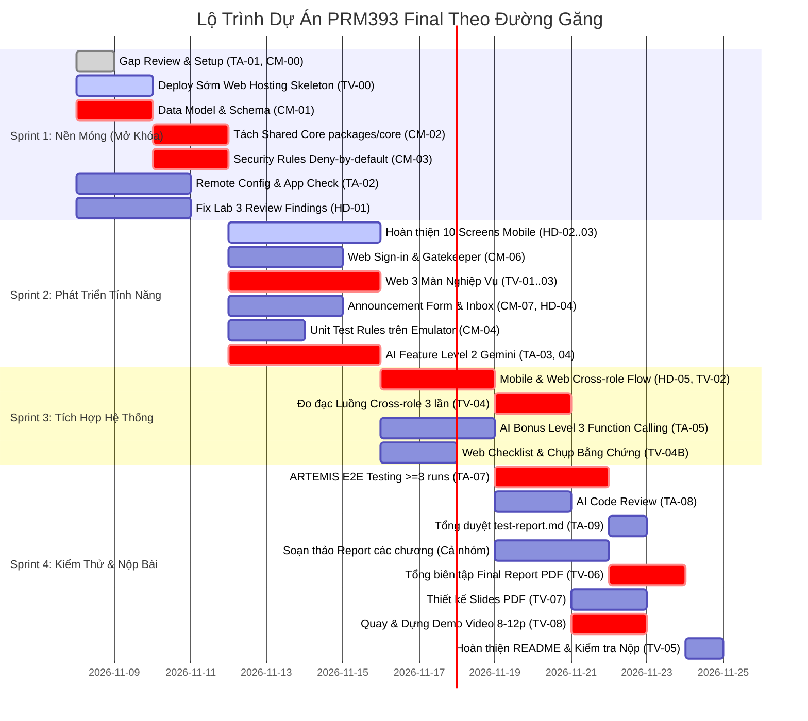

# Kế Hoạch Phân Công Task Chi Tiết — PRM393 Final Assignment: One Complete System on Firebase

> **Học phần:** PRM393 — Lập trình Di động (Mobile Programming)  
> **Dự án:** Longvita — Hệ thống Quản lý Dinh dưỡng Trường thọ Đa nền tảng  
> **Kiến trúc:** Mobile App (Flutter) + Web Admin (Flutter Web) + Shared Core (`packages/core/`) + Cloud Firestore & Firebase Suite + AI Gemini  
> **Thành viên:** 4 thành viên (Thái An, Charlie Minh, Hoàng DV, Thắng VLQ)  
> **Thang điểm:** 10.0 điểm chính thức + 0.5 điểm Bonus (Mục tiêu nhóm: Đạt điểm tối đa)  
> **Tài liệu căn cứ:** Handout *PRM393 — Final Assignment: One Complete System on Firebase (No-Cost Plan)* (Lam Phuong, 21/10/2026)  
> **Trạng thái:** Đã qua rà soát toàn diện, khắc phục triệt để các hạng mục sót, sửa phụ thuộc đường găng và cân bằng tải chuẩn xác.

---

## 1. Cơ Cấu Vai Trò & Ánh Xạ Tiêu Chí Đánh Giá

### 1.1. Bảng phân định trách nhiệm chính
Mỗi tiêu chí đánh giá trong Rubric đều có một **Owner chính** chịu trách nhiệm nghiệm thu chất lượng và một **Co-owner** phối hợp thực hiện.

| Tiêu chí Rubric chính thức | Điểm | Người chịu trách nhiệm chính (Owner) | Thành viên phối hợp | Đầu ra nghiệm thu bắt buộc |
|:---|:---:|:---:|:---:|:---|
| **1. Mobile App: Scope Lab 2/3** | 1.25đ | **Hoàng DV** | Thái An | 10 screens Lab 2 & flows chạy mượt, đóng toàn bộ review findings |
| **2. Mobile App: Real Data & Inbox** | 0.75đ | **Hoàng DV** | Charlie Minh | 100% dữ liệu từ Firestore, Inbox cập nhật thời gian thực |
| **3. Web Admin: Screens & Actions** | 1.25đ | **Thắng VLQ** | Charlie Minh | 4 màn hình + Announcement Form, đủ 3 states (loading/empty/error) |
| **4. Web Admin: Design System & Deploy** | 0.75đ | **Thắng VLQ** | Charlie Minh | Tokens Lab 2, Layout màn rộng, Hosting URL chạy ở tab ẩn danh |
| **5. Backend: Data Model & Security Rules**| 1.00đ | **Charlie Minh** | Hoàng DV | `docs/data-model.md`, `firestore.rules`, Unit test emulator pass 100% |
| **6. Integration: Cross-role Flow** | 1.00đ | **Thắng VLQ** | Hoàng DV | Luồng 2 chiều chạy live trên bản deploy 3 lần, `docs/cross-role-flow.md` |
| **7. AI Feature: Level 2 Gemini** | 1.00đ | **Thái An** | Charlie Minh | Structured output, nhãn AI, cho phép sửa, Remote Config, zero PII |
| **8. Testing: ARTEMIS & Web Checklist** | 0.50đ | **Thái An** | Thắng VLQ | Test ARTEMIS $\ge 3$ runs, Web checklist ảnh chụp $\to$ `test-report.md` |
| **9. Code Quality: Architecture & Review**| 0.50đ | **Charlie Minh** | Thái An | Chuẩn MVVM 2 client, `packages/core/`, $\ge 3$ review findings |
| **10. Communication: Slides** | 1.00đ | **Thắng VLQ** | Thái An | `slides/Final_<ID>_slides.pdf` (12–15 slides), bằng chứng trên từng slide |
| **11. Communication: Demo Video** | 1.00đ | **Thắng VLQ** | Cả nhóm | Video live 8–12 phút, 2 màn hình side-by-side, test toggle Remote Config |
| **12. BONUS: AI Level 3 (Function Calling)**| **+0.50đ**| **Thái An** | Hoàng DV | AI tra cứu dữ liệu cá nhân (tính calo/protein tuần), zero PII |

---

## 2. Bảng Phân Công Công Việc Chi Tiết Từng Thành Viên

### 2.1. Thái An — Team Leader, AI Feature Lead & QA/Testing Lead
*Chịu trách nhiệm toàn diện về chất lượng hệ thống, tính năng AI Gemini, kiểm thử E2E và chủ sở hữu tài liệu `docs/test-report.md`.*

| Task ID | Giai đoạn | Tên Task & Nội Dung Chi Tiết | Phụ thuộc | Đóng góp vào tiêu chí | Đầu ra / Bằng chứng |
|:---|:---:|:---|:---:|:---:|:---|
| **TA-01** | Stage 1 | **Gap Review Lab 2 & Lab 3**: Soát lại chênh lệch giữa thiết kế Lab 2, kết quả Lab 3 và đề Final; lập checklist đóng toàn bộ gaps. | — | Mobile scope (1.25đ) | `docs/gap-review.md` |
| **TA-02** | Stage 2 | **Cấu hình Remote Config & App Check**: Cấu hình Remote Config in-app defaults & flags trên console (`gemini_model_name`, `prompt_template`, `ai_feature_enabled`); bật App Check cho Firestore và AI Logic. *(Làm độc lập ngay từ đầu, không bị chặn bởi Backend)* | — | AI Feature (1.0đ) | `firebase/remote-config-defaults.json`, evidence App Check |
| **TA-03** | Stage 5 | **Gemini AI Feature (Level 2 — Structured Output)**: Tích hợp Firebase AI Logic / Gemini API tại bước S03 (hoặc S06) của Lab 2 để phân tích/gợi ý thực đơn trường thọ; xuất JSON mapping thẳng vào Dart Model; bắt buộc gắn nhãn *"AI-Generated"* và cho phép người dùng chỉnh sửa trước khi lưu. | TA-02, CM-02 | AI Feature (1.0đ) | `lib/services/ai/`, cập nhật `docs/ai-feature.md` |
| **TA-04** | Stage 5 | **AI Safety, Fallback & Logging**: Tuyệt đối không gửi PII (tên, email); xử lý lỗi mạng/quota để app không sập (fallback về công thức chuẩn); log đầy đủ `ai_request`, `ai_result_accepted`, `ai_error` lên Analytics. | TA-03 | AI Feature (1.0đ) | Code fallback, Analytics DebugView evidence |
| **TA-05** | Stage 5 | **AI Bonus Feature (Level 3 — Function Calling)**: Xây dựng trợ lý AI tra cứu trực tiếp trên dữ liệu dinh dưỡng cá nhân của người dùng (ví dụ: *"Tuần này tôi đã nạp bao nhiêu gram protein từ thực đơn đang áp dụng?"*), khử sạch dữ liệu định danh trước khi gọi model. | TA-03 | **BONUS (+0.5đ)** | Code Function Calling, `docs/ai-feature.md` |
| **TA-06** | Stage 5 | **Tài liệu hóa AI Feature**: Viết báo cáo chi tiết theo đề bài gồm 3 cặp input/output thực tế và 1 kịch bản lỗi mạng/quota được xử lý êm đẹp. | TA-04 | AI Feature (1.0đ) | `docs/ai-feature.md` |
| **TA-07** | Stage 6 | **Google ARTEMIS Mobile E2E Testing**: Viết và chạy E2E cho mọi flow Lab 2, các bước mobile của luồng Cross-role, và tính năng AI; mỗi flow chạy $\ge 3$ lần tính tỷ lệ pass rate. | HD-04, HD-05, TA-03 | Tests (0.5đ) | `e2e_test/`, bảng pass rate trong `docs/test-report.md` |
| **TA-08** | Stage 6 | **AI Code Review**: Chạy AI Code Review trên PR/code mới, ghi nhận $\ge 3$ findings kèm quyết định sửa đổi, lý do và commit fix liên kết. | Code hoàn tất | Architecture & Review (0.5đ) | Mục AI Code Review trong `docs/test-report.md` |
| **TA-09** | Stage 6 | **Chủ sở hữu & Tổng duyệt `docs/test-report.md`**: Tổng hợp kết quả từ ARTEMIS (TA-07), Unit test Security Rules (CM-04), Web Checklist (Thắng chụp - TA kiểm duyệt), và AI Code Review (TA-08). | TA-07, CM-04, TV-04B, TA-08 | Tests (0.5đ) | `docs/test-report.md` hoàn chỉnh |
| **TA-10** | Stage 6 | **Soạn thảo Báo cáo Module AI & Testing**: Viết Chương 6 (AI Feature), Chương 7 (Testing), Chương 8 (Code Review) và đóng góp 3–5 gạch đầu dòng Bài học kinh nghiệm. | TA-06, TA-09 | Report bắt buộc | Bản nháp gửi Thắng tổng hợp kèm link `evidence/` |

---

### 2.2. Charlie Minh — Core Architecture, Backend & Security Lead
*Tập trung giải phóng đường găng ở Sprint 1 (Data Model, Shared Package, Security Rules), sau đó làm Unit test Emulator, Auth Web và Announcement Form.*

| Task ID | Giai đoạn | Tên Task & Nội Dung Chi Tiết | Phụ thuộc | Đóng góp vào tiêu chí | Đầu ra / Bằng chứng |
|:---|:---:|:---|:---:|:---:|:---|
| **CM-00** | Stage 1 | **Khởi tạo Khung Thư mục & Bằng chứng**: Chuẩn bị cấu trúc thư mục `packages/core/`, `mobile/`, `web/`, và phân nhánh `evidence/` (`evidence/auth/`, `evidence/rules/`, `evidence/web/`, `evidence/cross_role/`, `evidence/ai/`). | — | Điều kiện cần | Khung thư mục repo sạch |
| **CM-01** | Stage 2 *(Ưu tiên 1)* | **Thiết kế Data Model & Phân quyền (Appendix A)**: Chuẩn hóa schema các collection (`users`, `recipes`, `meal_plans`, `announcements`), định nghĩa role (`user`, `staff`, `admin`), các bước chuyển đổi trạng thái hợp lệ. | — | Data Model & Rules (1.0đ) | `docs/data-model.md` |
| **CM-02** | Stage 2 *(Ưu tiên 1)* | **Tách Shared Package (`packages/core/`)**: Đóng gói models dùng chung, Firestore services, Design Tokens theme Lab 2, 9 common widgets sang `packages/core/` độc lập để Mobile và Web cùng import. | CM-01 | Architecture (0.5đ) | Thư mục `packages/core/` độc lập |
| **CM-03** | Stage 2 *(Ưu tiên 1)* | **Security Rules Deny-by-default**: Viết `firestore.rules` cấm toàn bộ theo mặc định (không dùng `if true`), kiểm soát quyền theo `users/{uid}.role`, validate cấu trúc dữ liệu và điều kiện chuyển trạng thái. | CM-01 | Data Model & Rules (1.0đ) | `firebase/firestore.rules` |
| **CM-04** | Stage 2 | **Unit Test Security Rules trên Emulator (Appendix B)**: Xây dựng bộ test trên Firebase Emulator với $\ge 1$ test Allowed và $\ge 1$ test Denied cho từng role trên từng collection theo mẫu Appendix B (100% pass). | CM-03 | Data Model & Rules (1.0đ) + Tests (0.5đ) | `firebase/tests/rules.test.js`, test logs 100% pass |
| **CM-05** | Stage 2 | **Khởi tạo Admin Đầu tiên & Role Management**: Khởi tạo tài khoản Admin đầu tiên qua Firebase Console; viết quy tắc chỉ Admin mới đổi được role và không ai tự đổi role của mình; ghi rõ thông tin trong README. | CM-03 | Data Model & Rules (1.0đ) | Cấu hình user Console, `README.md` |
| **CM-06** | Stage 4 | **Web Sign-in Screen & Role Gatekeeper**: Màn hình đăng nhập Google trên Web Admin, kiểm tra `users/{uid}.role`, từ chối ngay lập tức tài khoản không thuộc vai trò Staff/Admin kèm thông báo lỗi rõ ràng. Đạt chuẩn Loading/Error state và Tokens Lab 2. | CM-02, CM-03, TV-00 | Web screens (1.25đ) | Màn hình `SignInWebScreen` |
| **CM-07** | Stage 4 | **Announcement Form trên Web Admin**: Xây dựng form soạn và phát thông báo ghi thẳng vào collection `announcements` (liên thông trực tiếp với Inbox Mobile). Đạt chuẩn Validation, Tokens Lab 2. | CM-01, CM-06 | Web screens (1.25đ) | Component `AnnouncementForm` |
| **CM-08** | Stage 6 | **Soạn thảo Báo cáo Module Backend & Security**: Viết Chương 2 (Kiến trúc Monorepo & Shared Core), Chương 3 (Data Model & Security Rules) và đóng góp 3–5 gạch đầu dòng Bài học kinh nghiệm. | CM-01..CM-05 | Report bắt buộc | Bản nháp gửi Thắng tổng hợp kèm link `evidence/` |

---

### 2.3. Hoàng DV — Mobile App & Domain/Flows Lead
*Chịu trách nhiệm hoàn thiện 100% ứng dụng Mobile, kết nối dữ liệu Firestore thật, Hòm thư thông báo, bảo mật vai trò phía mobile và luồng Cross-role.*

| Task ID | Giai đoạn | Tên Task & Nội Dung Chi Tiết | Phụ thuộc | Đóng góp vào tiêu chí | Đầu ra / Bằng chứng |
|:---|:---:|:---|:---:|:---:|:---|
| **HD-01** | Stage 1 & 3 | **Đóng toàn bộ Review Findings Lab 3**: Rà soát và sửa dứt điểm các lỗi còn tồn đọng từ Lab 3 (lỗi giao diện, state rỗng, phím back, a11y, theme). | TA-01 | Mobile scope (1.25đ) | Nhật ký fix trong `docs/gap-review.md` |
| **HD-02** | Stage 3 | **Hoàn thiện 10 màn hình Mobile (Lab 2 Scope)**: Đảm bảo toàn bộ 10 màn hình chuẩn và 3 luồng người dùng (S01–S10) hoạt động trơn tru trong thư mục `mobile/`, kết nối 100% dữ liệu Firestore thật qua `packages/core/`. Đạt chuẩn kiến trúc MVVM. | CM-02, HD-01 | Mobile scope (1.25đ) | Code `mobile/lib/screens/`, `viewmodels/` |
| **HD-03** | Stage 3 | **Chuẩn hóa States (Loading, Empty, Error, Data)**: Mọi màn hình tải dữ liệu đều có thông báo rõ ràng, nút Thử lại (Retry), xử lý mất mạng, không bao giờ có spinner vô tận hay màn hình trắng. | HD-02 | Real data (0.75đ) | Bằng chứng test offline/error |
| **HD-03B** | Stage 3 | **Mobile Role Gatekeeper & User Bootstrap**: Khi đăng nhập lần đầu trên Mobile, tự động tạo `users/{uid}` với `role = 'user'`. Nếu tài khoản có role khác hoặc không hợp lệ, Mobile từ chối với thông báo rõ ràng ("each client rejects accounts of the wrong role"). | CM-03, HD-02 | Data Model & Rules (1.0đ) | Code AuthGate & bootstrap mobile |
| **HD-04** | Stage 3 | **Hòm thư thông báo Mobile (Announcement Inbox)**: Xây dựng giao diện Inbox lắng nghe Firestore stream từ collection `announcements`, cập nhật tin tức thời gian thực từ Web Admin. | CM-01, HD-02 | Real data & inbox (0.75đ) | UI Inbox, snapshot listener code |
| **HD-05** | Stage 5 | **Mobile Cross-role Flow Integration**: Người dùng (Bác Hoàng) bấm gửi thực đơn tuần lên chuyên gia dinh dưỡng xét duyệt (`status: 'pending'`), màn hình hiển thị trạng thái chờ, tự động cập nhật sang `approved` khi Web duyệt. *(Phần code chỉ cần CM-03; khi test live mới cần TV-02)* | CM-03 | Cross-role flow (1.0đ) | Code submit & stream listener mobile |
| **HD-06** | Stage 3 | **Export PDF Offline & Metadata Firestore**: Giữ logic xuất PDF lưu và chia sẻ trên thiết bị (Lab 3), lưu metadata lịch sử vào Firestore (không dùng Cloud Storage). | HD-02 | Mobile scope (1.25đ) | Code sinh file PDF local & update doc |
| **HD-07** | Stage 3 | **Tích hợp Firebase Crashlytics & Analytics trên Mobile**: Cài đặt Crashlytics bắt crash trên thiết bị thật; log các sự kiện luồng chính (`view_recipe`, `create_plan`, `submit_plan`) lên Analytics. | HD-02 | Analytics & Crashlytics | Logs DebugView & Crashlytics console |
| **HD-08** | Stage 6 | **Soạn thảo Báo cáo Module Mobile App**: Viết Chương 1 (Thay đổi so với Lab 3 & Hoàn thiện Mobile App) và đóng góp 3–5 gạch đầu dòng Bài học kinh nghiệm. | HD-01..HD-06 | Report bắt buộc | Bản nháp gửi Thắng tổng hợp kèm link `evidence/` |

---

### 2.4. Thắng VLQ — Web Admin Core & Media/Documentation Lead
*Chịu trách nhiệm phát triển Web Admin, deploy Hosting sớm, tài liệu hóa luồng Cross-role, tổng biên tập Báo cáo, Slides và quay dựng Demo Video.*

| Task ID | Giai đoạn | Tên Task & Nội Dung Chi Tiết | Phụ thuộc | Đóng góp vào tiêu chí | Đầu ra / Bằng chứng |
|:---|:---:|:---|:---:|:---:|:---|
| **TV-00** | Stage 1 | **Dựng Khung Flutter Web & Deploy Sớm Firebase Hosting**: Thiết lập dự án `web/`, cấu hình `firebase.json` Hosting, build và deploy ngay bản skeleton để URL luôn sống và mở được ở tab ẩn danh xuyên suốt dự án. | — | Design system & deploy (0.75đ) | Live URL Firebase Hosting hoạt động |
| **TV-01** | Stage 4 | **Web Management Screen (Quản lý Thực thể)**: Màn hình danh sách, tìm kiếm, tạo mới, chỉnh sửa và lưu trữ (archive/soft-delete) công thức món ăn (Recipes) mà Mobile đọc được. Đạt chuẩn Wide-screen layout, Tokens Lab 2, MVVM, Loading/Empty/Error states. | CM-02, CM-06 | Web screens (1.25đ) | Màn hình `RecipeManagementScreen` |
| **TV-02** | Stage 4 | **Web Review Queue Screen (Hàng đợi Xét duyệt)**: Màn hình hiển thị danh sách thực đơn người dùng gửi lên (`pending`); Staff thẩm định và bấm Duyệt (Approve) hoặc Từ chối (Reject) kèm lý do. Đạt chuẩn Wide-screen, Tokens Lab 2, MVVM, Loading/Empty/Error states. | CM-01, CM-06 | Web screens (1.25đ) + Cross-role (1.0đ) | Màn hình `ReviewQueueScreen` |
| **TV-03** | Stage 4 | **Web Dashboard Screen (Thống kê & Biểu đồ)**: Hiển thị $\ge 3$ chỉ số thống kê từ Aggregation queries hợp lệ (tổng công thức `recipes`, thực đơn chờ duyệt `pending`, thực đơn đã duyệt `approved` — tránh truy vấn cấm trên `users`) + 1 biểu đồ chart trực quan. | CM-01, CM-06 | Web screens (1.25đ) | Màn hình `DashboardScreen` |
| **TV-03B** | Stage 4 | **Tích hợp Firebase Analytics & Remote Config trên Web**: Đọc giá trị Remote Config hiển thị cờ giao diện web; log sự kiện thao tác staff (`approve_plan`, `reject_plan`, `publish_announcement`) lên Analytics. | TV-00, TA-02 | Analytics & RC | DebugView logs trên Web |
| **TV-04** | Stage 5 | **Đặc tả & Đo đạc Luồng Liên vai trò (`docs/cross-role-flow.md`)**: Mô tả chi tiết từng bước tương tác giữa User (Mobile) và Staff (Web), sơ đồ Sequence Diagram (Mermaid), **chạy live trên hệ thống đã deploy 3 lần** và ghi nhận bảng số liệu độ trễ đồng bộ (ms). | HD-05, TV-02, TV-00 | Cross-role flow (1.0đ) | `docs/cross-role-flow.md` kèm bảng 3 lần test |
| **TV-04B** | Stage 4 & 6 | **Thực thi Web Admin Checklist (Chụp ảnh Bằng chứng)**: Chụp đầy đủ ảnh cho từng màn hình Web: 1 ảnh hành động chính, 1 ảnh từ chối sai role, 1 ảnh empty state, 1 ảnh error state $\to$ gửi Thái An kiểm duyệt đưa vào `docs/test-report.md`. | TV-01..TV-03, CM-06, CM-07 | Tests (0.5đ) | Thư mục `evidence/web/` |
| **TV-05** | Stage 6 | **Hoàn thiện `README.md` Toàn diện**: Biên tập đầy đủ các mục: roles, live Web URL, cách chạy client + emulator, tài khoản demo cho từng role, phiên bản thư viện/Flutter, **danh sách AI tools đã dùng**, link video demo. | Toàn bộ dự án | README bắt buộc | `README.md` chuẩn Section 10 |
| **TV-06** | Stage 6 | **Tổng biên tập Final Report PDF (10–15 trang)**: Soạn Chương 4 (Web Admin), Chương 5 (Cross-role flow), gom các chương từ TA-10, CM-08, HD-08 thành file báo cáo chuẩn chỉnh, mọi khẳng định đều dẫn link `evidence/`, xuất ra `report/Final_<ID>.pdf`. | TA-10, CM-08, HD-08 | Report bắt buộc | `report/Final_<ID>.pdf` (10–15 trang) |
| **TV-07** | Stage 6 | **Thiết kế Slides PDF (12–15 trang)**: Thiết kế bộ slide thuyết trình súc tích, mọi slide "it works" đều có ảnh chụp bằng chứng rõ ràng, dễ đọc, xuất ra `slides/Final_<ID>_slides.pdf`. *(Thực hiện song song khi hệ thống ổn định, không chờ report)* | Hệ thống chạy ổn định | Slides (1.0đ) | `slides/Final_<ID>_slides.pdf` (12–15 slides) |
| **TV-08** | Stage 6 | **Quay & Dựng Demo Video (8–12 phút, Live)**: Quay song song 2 màn hình (Mobile & Web side-by-side) thể hiện trọn vẹn luồng Cross-role real-time, thao tác đổi Remote Config tắt/bật AI, test run hệ thống; xuất link unlisted YouTube/Drive. | Hệ thống deploy hoàn tất | Demo Video (1.0đ) | Đường link Video mở công khai |

---

## 3. Quy Chuẩn Definition of Done (DoD) Toàn Dự Án

Mọi màn hình và tính năng trước khi đánh dấu Hoàn thành (Done) bắt buộc phải đáp ứng:
1. **Kiến trúc MVVM chuẩn**: Tuyệt đối không gọi SDK Firebase trực tiếp trong hàm `build()` của Widget. Toàn bộ logic nghiệp vụ và state management phải thông qua ViewModel (Provider) và Service Interface.
2. **Quy chuẩn 4 States cho mọi màn hình**: Bắt buộc có đủ `LoadingView` (spinner không vô tận), `EmptyStateView` (icon + thông điệp + CTA), `ErrorStateView` (nút Retry + thông báo lỗi thân thiện) và `DataView`.
3. **Design System Lab 2 & Layout màn rộng**: Tái sử dụng 100% Design Tokens (màu sắc, typography, spacing, radius) từ `packages/core/`. Giao diện Web Admin phải chia cột responsive theo tài liệu `flutter-handoff.md`.
4. **Phân quyền Role-based nghiêm ngặt**:
   - Web: Chỉ cho phép tài khoản có `users/{uid}.role` là `staff` hoặc `admin` truy cập; tài khoản `user` bị đẩy ra kèm thông báo lỗi rõ ràng.
   - Mobile: Chỉ cho phép tài khoản có `role == 'user'`; từ chối các role khác hoặc tự động khởi tạo `role = 'user'` nếu đăng nhập lần đầu.
5. **Minh chứng `evidence/`**: Mọi tính năng, test case và màn hình đều phải lưu ảnh chụp hoặc log tương ứng vào thư mục `evidence/` để phục vụ trích dẫn trong Report và Slides.

---

## 4. Giải Quyết 5 Điểm Rủi Ro Nội Dung Cốt Lõi

1. **Khớp luồng Cross-role với phạm vi Lab 2/3 (Tránh bị trừ điểm do tính năng mới):**
   - *Bản chất nghiệp vụ:* Kế thừa trực tiếp màn hình `S04` (Weekly Meal Plan) của Lab 2. Người dùng sau khi tạo xong thực đơn tuần có nút *"Gửi chuyên gia thẩm định"* $\to$ ghi trạng thái `status: 'pending'` vào `meal_plans/{id}`.
   - *Phía Web:* Chuyên gia dinh dưỡng (Staff) thẩm định sự cân đối dinh dưỡng (calo, đạm thực vật) trên Review Queue, bấm Duyệt (`approved`) hoặc Từ chối (`rejected`) kèm nhận xét.
   - *Đồng bộ real-time:* Mobile lắng nghe stream tự động cập nhật banner trạng thái và nhận thông báo trong Inbox. Luồng này kế thừa 100% entity Lab 2/3, hoàn toàn hợp lệ theo đề bài.
2. **Khắc phục lỗi Aggregation Query trên Dashboard Web:**
   - Security Rules theo Appendix A quy định `users` chỉ cho đọc: `Self; admin`. Nhân viên `staff` sẽ bị Rules chặn nếu truy vấn đếm trên collection `users`.
   - *Giải pháp:* Dashboard dành cho Staff sẽ thống kê trên các collection hợp lệ mà Staff được phân quyền:
     - Số lượng công thức món ăn (`recipes`).
     - Số lượng thực đơn đang chờ duyệt (`meal_plans` với `status == 'pending'`).
     - Số lượng thực đơn đã thẩm định trong tháng (`meal_plans` với `status == 'approved'`).
     - Biểu đồ phân bổ calo hoặc danh mục món ăn. Nếu muốn hiển thị tổng số user, chỉ mở riêng card này cho role `admin` hoặc lưu vào counter `stats/platform_summary`.
3. **Chuẩn mực AI Gemini Level 2 (TA-03):**
   - Tích hợp tại bước S03 (Tạo thực đơn) hoặc S06 (Thay thế món). Kết quả trả về phải có nhãn rõ ràng: *"Được tạo bởi AI — Hãy kiểm tra lại dinh dưỡng"*, và người dùng được quyền bấm chỉnh sửa từng nguyên liệu trước khi lưu vào thực đơn.
4. **Bảo mật dữ liệu cá nhân trong Function Calling Level 3 (TA-05):**
   - Payload gửi lên Gemini Function Calling chỉ chứa: cân nặng mục tiêu, số bữa ăn, danh sách ID món ăn và chỉ số dinh dưỡng (calo, protein). Tuyệt đối khử sạch tên, email, ảnh chân dung của người dùng.
5. **Cơ chế Commit Git & Chuẩn bị Vấn đáp 10 phút (Section 12):**
   - Cả 4 thành viên phải duy trì commit đều đặn qua các ngày bằng chính email trường của mình.
   - Tổ chức buổi Mock Viva nội bộ: cả nhóm cùng luyện tập chạy luồng Cross-role, thao tác Remote Config bật/tắt AI trên console, giải thích 1 rule bảo mật và 1 quyết định prompt AI.

---

## 5. Lộ Trình 4 Sprint Theo Đường Găng (Critical Path Timeline)

### Các mốc bàn giao then chốt (Milestones):
- **Cột mốc M1 (Hết Sprint 1 — Ngày 3):** Mở khóa toàn bộ đường găng! `packages/core/` sẵn sàng, `docs/data-model.md` và `firestore.rules` đã chốt; URL Web Hosting đã live và truy cập được ở chế độ ẩn danh.
- **Cột mốc M2 (Hết Sprint 2 — Ngày 7):** Mobile chạy 100% dữ liệu thật; Web Admin hoàn thành các màn hình cơ bản; Unit test Security Rules đạt 100% pass trên Emulator; AI Level 2 hoạt động có Remote Config bật/tắt.
- **Cột mốc M3 (Hết Sprint 3 — Ngày 10):** Thông luồng Cross-role live thành công 3 lần trên hệ thống deploy thật; hoàn thành AI Bonus Level 3; thư mục `evidence/` gom đủ ảnh chụp và logs.
- **Cột mốc M4 (Hết Sprint 4 — Ngày 13):** ARTEMIS pass rate $\ge 95\%$; hoàn tất `docs/test-report.md`; Báo cáo PDF (10–15 tr), Slides PDF (12–15 tr) và Video demo (8–12 min) sẵn sàng nộp bài.

---

## 6. Phân Công Chi Tiết 9 Chương Của Final Report (10–15 Trang)

Để tránh dồn việc và đảm bảo tính chân thực theo tiêu chuẩn của giảng viên, Báo cáo được phân bổ cụ thể cho từng thành viên soạn thảo:

| Chương | Tên Chương Mục | Người soạn thảo chính | Nội dung & Yêu cầu bằng chứng |
|:---:|:---|:---:|:---|
| **Chương 1** | **Thay đổi so với Lab 3 & Hoàn thiện Mobile** | **Hoàng DV** | Mô tả các điểm cải tiến từ Lab 3, bằng chứng đóng review findings, hoàn thiện 10 màn Lab 2. |
| **Chương 2** | **Kiến trúc Monorepo & Shared Core** | **Charlie Minh** | Cấu trúc thư mục, layer diagram, mô hình MVVM ở cả 2 client, phân tách `packages/core/`. |
| **Chương 3** | **Data Model & Security Rules** | **Charlie Minh** | Bảng schema Appendix A, logic phân quyền theo role, bằng chứng test emulator 100% pass. |
| **Chương 4** | **Web Admin & Triển khai Hosting** | **Thắng VLQ** | 4 màn hình Web, Announcement Form, tokens Lab 2, layout màn rộng, bằng chứng URL Hosting. |
| **Chương 5** | **Luồng Liên vai trò (Cross-role Flow)** | **Thắng & Hoàng** | Sequence diagram (Mermaid), mô tả từng bước, bảng số liệu độ trễ 3 lần chạy live. |
| **Chương 6** | **Tính năng AI Gemini (Level 2 & Level 3)** | **Thái An** | 3 cặp input/output thật, 1 kịch bản lỗi, cấu hình Remote Config, bảo mật zero PII. |
| **Chương 7** | **Báo cáo Kiểm thử Hệ thống** | **Thái An** | Bảng kết quả ARTEMIS ($\ge 3$ runs), Web checklist ảnh chụp, Security rules tests. |
| **Chương 8** | **AI Code Review & Tối ưu Chất lượng** | **Thái An** | $\ge 3$ findings có quyết định xử lý, lý do kỹ thuật và bằng chứng commit fix. |
| **Chương 9** | **Bài học Kinh nghiệm (Lessons Learned)** | **Cả 4 thành viên** | Mỗi thành viên đóng góp 3–5 gạch đầu dòng thực tế về kỹ thuật, teamwork và Firebase. |
| **Biên tập** | **Tổng biên tập, Định dạng & Xuất bản PDF** | **Thắng VLQ** | Gom các chương, chuẩn hóa định dạng, mục lục, bảng biểu, xuất `report/Final_<ID>.pdf`. |
