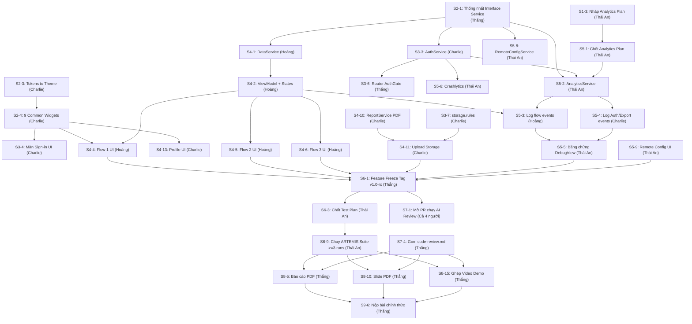

# Mốc Quan Trọng & Phân Tích Đường Găng (Critical Path)

> Tài liệu trích xuất từ kế hoạch Excel Lab 3: xác định các mốc bàn giao then chốt (Milestones M1–M9) và các phụ thuộc bắt buộc giữa các thành viên.

---

## 1. Bảng 9 Mốc Quan Trọng (Milestones M1–M9)

| Mốc | Tên mốc | Điều kiện hoàn thành | Người chịu trách nhiệm | Tuần | Đạt? |
|:---:|:---|:---|:---:|:---:|:---:|
| **M1** | Nền móng | Traceability, interface service, theme, khung lib/ đã xong; repo, Firebase project, tài khoản test sẵn sàng | Thắng | 1 | ⏳ Chưa |
| **M2** | Đăng nhập chạy | Google Sign-In, routing theo auth state, `storage.rules`, widget dùng chung đã xong | Charlie | 2 | ⏳ Chưa |
| **M3** | Flow đầu tiên | Flow 1 chạy end-to-end với dữ liệu thật; `analytics-plan.md` đã chốt | Hoàng | 2 | ⏳ Chưa |
| **M4** | Tính năng đầy đủ | Mọi flow, export + upload, FCM, Remote Config, Crashlytics, analytics hoạt động | Thắng | 3 | ⏳ Chưa |
| **M5** | Feature freeze | Tag bản build ổn định (`git tag v1.0-rc`); từ đây chỉ sửa bug, cấm thêm tính năng mới | Thắng | 3 | ⏳ Chưa |
| **M6** | ARTEMIS hoàn tất | $\ge 10$ test cases, mỗi test chạy $\ge 3$ lần, bảng pass rate, phiên exploratory xong | Thái An | 4 | ⏳ Chưa |
| **M7** | Code review xong | $\ge 5$ findings, $\ge 3$ commit fix liên kết, `code-review.md` hoàn chỉnh | Thắng | 4 | ⏳ Chưa |
| **M8** | Báo cáo, Slide, Video | Cả 3 sản phẩm hoàn chỉnh và mở xem được ở chế độ ẩn danh (incognito) | Thắng | 4 | ⏳ Chưa |
| **M9** | Nộp bài | Kiểm tra cuối đạt; nộp link repo, report PDF, slide PDF, video link | Thắng | 4 | ⏳ Chưa |

---

## 2. Phân Tích Đường Găng & Phụ Thuộc Quan Trọng (Critical Path)

Các task nằm trên đường găng nếu bị trễ sẽ trực tiếp làm trễ tiến độ toàn bộ dự án:

### Bảng Chi Tiết Lý Do Phụ Thuộc

| Việc phải xong trước | $\to$ Việc chờ | Người liên quan | Lý do kỹ thuật / Quy định handout |
|:---|:---|:---:|:---|
| **S2-1** (Interface service) | **S4-1, S3-3, S5-2, S5-8** | Thắng $\to$ Hoàng, Charlie, Thái An | B, C, D cần interface chung để code song song độc lập; ViewModel có thể test với Fake Service trước khi nối Firebase thật. |
| **S2-3, S2-4** (Theme, Common Widgets) | **S3-4, S4-4 $\to$ S4-6, S4-13** | Charlie $\to$ Hoàng, Thắng | Handout Mục 5 cấm hard-code màu/kích thước trong màn hình. Mọi màn hình phải dựng từ 9 widget dùng chung. |
| **S3-3** (Google Sign-In) | **S3-6, S5-2, S5-6** | Charlie $\to$ Thắng, Thái An | Cần UID người dùng để set User ID cho Analytics và Crashlytics; Router cần Auth State để điều hướng Sign-in $\leftrightarrow$ Home. |
| **S4-2** (ViewModel + Explicit State) | **S4-4 $\dots$ S4-7, S5-3, S5-8** | Hoàng $\to$ Thái An | Toàn bộ nghiệp vụ hiển thị, log event phân tích và tham số Remote Config đều gắn vào ViewModel. |
| **S1-3 $\to$ S5-1** (Analytics Plan) | **S5-2 $\to$ S5-5** | Thái An $\to$ Hoàng, Charlie | **Quy định bắt buộc:** Handout Mục 6 yêu cầu thiết kế kế hoạch sự kiện TRƯỚC KHI viết mã tracking. |
| **S4-10** (PDF) + **S3-7** (Storage Rules) | **S4-11** (Upload Storage) | Charlie | Upload cần file thật sinh ra từ dữ liệu màn hình và security rule `reports/{uid}/...` phải đúng thì mới không bị permission denied. |
| **S6-1** (Feature Freeze) | **S6-3 $\dots$ S6-11** (ARTEMIS Tests) | Thắng $\to$ Thái An | Google ARTEMIS thao tác qua UI agent trên thiết bị thật/emulator; nếu UI thay đổi liên tục, test suite sẽ bị flaky/fail. |
| **S6-9, S6-10** (Chạy ARTEMIS suite) | **S8-4, S8-13, S8-5** | Thái An $\to$ Thắng | Báo cáo, slide và video demo bắt buộc phải có kết quả thật từ bảng pass-rate $\ge 3$ lần chạy. |
| **S7-2** (AI review findings của cả 4 người) | **S7-4** (Tổng hợp `code-review.md`) | Cả 4 người $\to$ Thắng | Mỗi người mở 1 PR cho phần mình làm, gom đủ $\ge 5$ findings thuộc $\ge 2$ nhóm loại khác nhau. |
| **S8-1 $\dots$ S8-4** (Nội dung báo cáo từng mảng) | **S8-5** (Ghép `report/Lab03_<ID>.pdf`) | Cả 4 người $\to$ Thắng | Thắng chịu trách nhiệm biên tập và dàn trang file PDF hoàn chỉnh từ 8–12 trang. |
