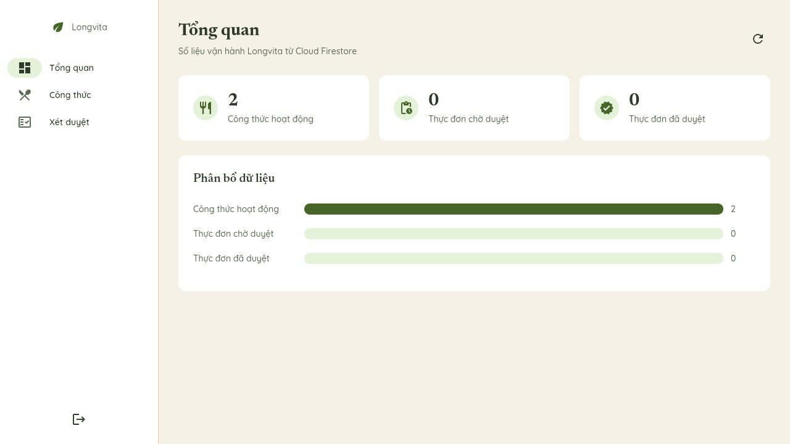

# CM-03 — đồng bộ Firestore rules, 11/11/2026

Bằng chứng chia sẻ được rút từ audit deploy/readback thực tế. Chỉ xuất các trường không định danh; không chứa actor documents, email, UID, credential hoặc đường dẫn máy. Snapshot phục hồi và log quản trị đầy đủ giữ riêng, không nằm trong gói này.

## Kết quả

| Mục | Giá trị đã kiểm |
| --- | --- |
| Project / database | `longvita-8da7e` / `(default)` |
| Source đối chiếu | main `aaae57d0a11a4e7ad9219a7ebc4192f73855a432`, rules blob `2c382be45b9ed55e0df40f6d01ba1b07230d00c1` |
| Lệnh triển khai | Official Firebase CLI, `deploy --only firestore:rules --project longvita-8da7e`, config chỉ có rules; exit0 |
| Release mới | `7eb64fde-6ba7-461f-81c2-707a9ae2eb10` |
| Thời gian release | `2026-11-10T17:02:54.186917Z` = **11/11/2026 00:02:54 VN** |
| Source server đọc lại | SHA256 `66eb848da878959d106db3e4f4f1da1a557231f0a84d0618ea88b4a00da8dcb3`, khớp từng byte target |
| Role trước/sau rollout | Giữ nguyên3admin/1user/1staff |
| Staff Web sau rollout | Dashboard: 2 công thức hoạt động, 0 thực đơn chờ duyệt, 0 thực đơn đã duyệt; danh sách 2 công thức; queue trống không lỗi quyền |

[verification.json](verification.json) ghi phạm vi và kết quả; [deployed-firestore.rules](deployed-firestore.rules) là source trả về từ active Firebase Rules ruleset sau deploy. Nó khớp [canonical rules](../../../firebase/firestore.rules) sau chuẩn hóa CRLF/LF của checkout Git; file readback giữ nguyên bytes để kiểm hash. [manifest.json](manifest.json) có hash của JSON, source readback và ảnh Dashboard.

`.gitattributes` trong riêng thư mục evidence này giữ nguyên xuống dòng của `.rules`/`.json`, để checkout trên Windows hay Linux không làm sai hash. Kiểm whitespace nhận CRLF là xuống dòng, vẫn kiểm khoảng trắng thừa và space-before-tab. Không thay cấu hình app, canonical rules hoặc thuộc tính của thư mục khác.

## Phạm vi kiểm và cách đọc số liệu

- Source không đổi từ [lượt Firestore Emulator103/103](../../web/CM-07-20261110/rules.txt); không chạy lại suite cho deploy hoặc báo cáo thuần tài liệu. Không gọi103là số ca production đã chạy.
- Ma trận [CM-04](../../rules/CM-04-20261109/README.md) có42case +1coveragecheck. Tổng117của gói đó gồm103Firestore +14StorageEmulator; không cộng42thêm lần nữa.
- Staff smoke là kiểm đọc qua client thật sau deploy, không phải toàn bộ negative/write matrix production. Không tạo/sửa/xóa dữ liệu nghiệp vụ trong rollout.
- Chỉ Firestore rules được deploy. Không ghi role, không đổi IAM/billing, không deploy Hosting/Storage/indexes. Không suy source SHA hoặc phiên bản CM-07 của Hosting từ lần deploy này.
- Metadata/source snapshot không phải managed backup toàn database. Không cần rollback trong lần triển khai này.

Xem [bản nháp CM-08](../../../docs/report-charlie-backend-security.md) để ghép các bằng chứng vào Chương2/3.
